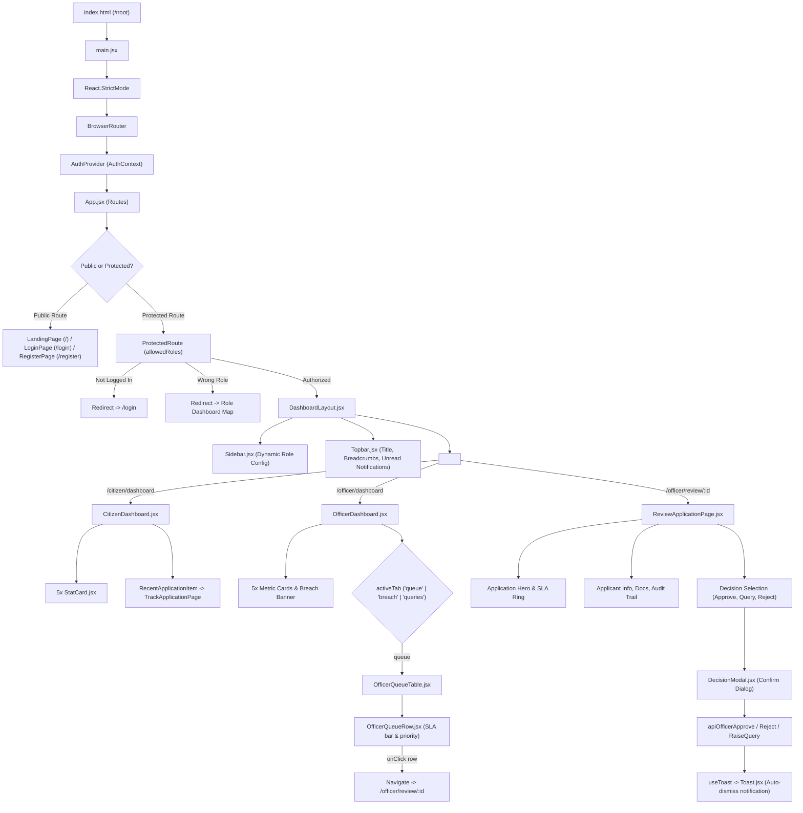

# DigiConnect — React.js Project Technical Analysis & Academic Evaluation Report

**Project Name:** DigiConnect — Unified Citizen Service Delivery Platform (UCSDP)  
**Repository:** `IIIT-Sricity-FSD-2024-2028/42_DigiConnect`  
**Evaluation Target:** React.js Frontend Architecture, Implemented Modules, and Individual Code Contributions  
**Evaluator/Student Identity Verified via Git:** `ganesh` (`vangarasundharsaiganesh@gmail.com`)  
**Deliverable Document:** `report.md` (Project Root)  
**Analysis Type:** Static Code Inspection, Dependency Tracing, Architectural Graphing, and Git Commit Audit  

---

## Table of Contents

1. [Section 1: Project Overview](#section-1-project-overview)
2. [Section 2: Project Directory Structure](#section-2-project-directory-structure)
3. [Section 3: Application Execution Flow](#section-3-application-execution-flow)
4. [Section 4: Detailed Analysis of Individual Contributions (13 Files)](#section-4-detailed-analysis-of-individual-contributions-13-files)
   - [4.1 StatCard.jsx](#41-statcardjsx)
   - [4.2 Sidebar.jsx](#42-sidebarjsx)
   - [4.3 Topbar.jsx](#43-topbarjsx)
   - [4.4 DashboardLayout.jsx](#44-dashboardlayoutjsx)
   - [4.5 CitizenDashboard.jsx](#45-citizendashboardjsx)
   - [4.6 App.jsx](#46-appjsx)
   - [4.7 src/api/officerApi.js](#47-srcapiofficerapijs)
   - [4.8 src/components/officer/OfficerQueueRow.jsx](#48-srccomponentsofficerofficerqueuerowjsx)
   - [4.9 src/components/officer/OfficerQueueTable.jsx](#49-srccomponentsofficerofficerqueuetablejsx)
   - [4.10 src/pages/officer/OfficerDashboard.jsx](#410-srcpagesofficerofficerdashboardjsx)
   - [4.11 src/pages/officer/ReviewApplicationPage.jsx](#411-srcpagesofficerreviewapplicationpagejsx)
   - [4.12 src/components/common/Toast.jsx](#412-srccomponentscommontoastjsx)
   - [4.13 src/hooks/useToast.js](#413-srchooksusetoastjs)
5. [Section 5: Component Communication and Data Flow](#section-5-component-communication-and-data-flow)
6. [Section 6: Officer Dashboard and Application Review Workflow](#section-6-officer-dashboard-and-application-review-workflow)
7. [Section 7: Toast Notifications and Custom Hook Architecture](#section-7-toast-notifications-and-custom-hook-architecture)
8. [Section 8: React Concepts for Viva Preparation](#section-8-react-concepts-for-viva-preparation)
9. [Section 9: Implemented Functionalities & Verification Status](#section-9-implemented-functionalities--verification-status)
10. [Section 10: Git History and Individual Contribution Audit](#section-10-git-history-and-individual-contribution-audit)
11. [Section 11: Testing and Execution Instructions](#section-11-testing-and-execution-instructions)
12. [Section 12: Bugs, Limitations, and Recommendations](#section-12-bugs-limitations-and-recommendations)
13. [Section 13: Viva Questions and Answers (Comprehensive Set)](#section-13-viva-questions-and-answers-comprehensive-set)
14. [Section 14: Live Code Modification Practice Exercises](#section-14-live-code-modification-practice-exercises)
15. [Section 15: Individual Contribution Summary for README](#section-15-individual-contribution-summary-for-readme)

---

## Section 1: Project Overview

### 1.1 Problem Statement and Domain Background
In traditional governance systems, citizen public service delivery is fragmented across disparate physical departments, paper-bound administrative files, uncoordinated field verification processes, and siloed grievance escalation channels. Citizens frequently experience delayed service delivery without SLA visibility, arbitrary rejections without documented justifications, and inability to track lifecycle statuses.

**DigiConnect (Unified Citizen Service Delivery Platform - UCSDP)** is engineered to solve these core governance bottlenecks by establishing a unified, multi-role digital gateway. It automates certificate issuance (Income, Caste, Residence), welfare scheme distribution, permission and NOC requests, record corrections, and administrative grievance redressals under strict, SLA-monitored workflows.

### 1.2 Target User Roles and Platform Personas
The system implements strict role-based access control (RBAC) and tailors distinct interface workflows for five distinct governance actors:
1. **Citizen (`citizen`):** Beneficiary who searches catalogs, applies for government certificates/welfare programs, uploads identity documents (Aadhaar, income certificates, ration proofs), tracks real-time progress, responds to verification queries, and files formal grievances.
2. **Department Field Officer (`officer`):** Verification authority who manages assigned regional queues, evaluates applicant claims, inspects documents, raises queries to citizens for clarifications, and issues approvals or rejections with mandatory audit remarks.
3. **Department Head / Supervisor (`department_head`, `supervisor`):** Supervisory administrator who oversees department-wide queues, configures services and dynamic workflow stages, assigns officer designations, monitors SLA breach thresholds, and reviews revenue analytics.
4. **State Administrator (`state_admin`):** Jurisdiction administrator who configures state-level administrative hierarchy trees (Districts, Mandals, Municipalities, Wards), creates departments, and establishes grievance redressal cells.
5. **Central Administrator / Super User (`central_admin`, `super_user`):** Federation administrator who oversees national state onboarding, inspects national application processing velocity, and tracks consolidated revenue figures.
6. **Grievance Redressal Officer (`grievance`, `grievance_officer`):** Specialized judicial/administrative officer investigating escalations, complaints, and service delays.

### 1.3 Technical Stack
- **Frontend Framework:** React 19 (`react` v19.2.8, `react-dom` v19.2.8).
- **Build Tool & Dev Server:** Vite 8 (`vite` v8.3.0, `@vitejs/plugin-react` v6.1.1).
- **Client-Side Routing:** React Router v7 (`react-router-dom` v7.18.4) using declarative `BrowserRouter`, `Routes`, `Route`, `Navigate`, `Outlet`, `useParams`, `useNavigate`, and `useLocation`.
- **Code Quality & Linting:** Oxlint (`oxlint` v1.81.0) with dedicated `.oxlintrc.json` rules.
- **Styling Architecture:** Pure Vanilla CSS with centralized design tokens and stylesheets (`style.css`, `dashboard.css`, `forms.css`, `landing.css`, `auth.css`), avoiding Tailwind utility overhead in the React bundle.
- **Backend Architecture:** A standalone NestJS REST API server located in the repository (`back-end/`, NestJS v11, Express platform, Throttler, Swagger UI).
- **Data Persistence:** The NestJS backend utilizes an in-memory database store (`back-end/src/data/store.ts` and `jurisdiction.data.ts`) pre-seeded with multi-jurisdiction entities. In the frontend, persistent session authentication state is synchronized with browser `localStorage`.
- **HTTP Client:** A lightweight, centralized native `fetch` wrapper (`front-end-react/src/api/client.js`) configured with base URL `http://localhost:3000/api/v1` that injects governance authentication headers (`x-role`, `x-user-id`, `x-state-id`, `x-department-id`, etc.) automatically.

---

## Section 2: Project Directory Structure

The DigiConnect repository is structured as a full-stack monorepo containing the NestJS backend, an earlier static HTML/CSS prototype (`front-end/`), reference database/SRS assets, and the active production React application (`front-end-react/`).

```text
42_DigiConnect/
├── back-end/                                # NestJS REST API Server
│   ├── src/
│   │   ├── applications/                    # Applications Controller, Service, DTOs
│   │   ├── data/store.ts                    # In-Memory Database Store & Seed Entities
│   │   ├── users/                           # User Authentication & Profiles
│   │   ├── grievances/                      # Grievance Lifecycle Engine
│   │   ├── services/                        # Service Catalog Management
│   │   ├── notifications/                   # Notification Triggers
│   │   └── main.ts                          # Backend Bootstrap (Port 3000, CORS, Global Pipes)
│   ├── package.json                         # Backend Dependencies (NestJS 11, Swagger, Throttler)
│   └── tsconfig.json                        # TypeScript Configuration
│
├── front-end-react/                         # Core Production React Application
│   ├── index.html                           # Single-Page Application Host HTML
│   ├── package.json                         # React 19 & React Router 7 Dependencies
│   ├── vite.config.js                       # Vite Bundler Configuration
│   ├── .oxlintrc.json                       # Oxlint Static Analysis Rules
│   └── src/
│       ├── main.jsx                         # React Root Entry Point (createRoot, Router, AuthProvider)
│       ├── App.jsx                          # Main Application Router & Route Hierarchy
│       │
│       ├── api/                             # Centralized HTTP API Modules (Fetch Client)
│       │   ├── client.js                    # Core apiFetch() Wrapper with Automatic Governance Headers
│       │   ├── officerApi.js                # Field Officer API Services (Queue, Actions, Chart)
│       │   ├── citizenApi.js                # Citizen API Services (Applications, Grievances)
│       │   ├── authApi.js                   # Authentication & Session Endpoints
│       │   ├── departmentHeadApi.js         # Dept Head Services & Officer Management
│       │   ├── stateAdminApi.js             # Jurisdictions & Department Configuration
│       │   ├── centralAdminApi.js           # National Federation API Endpoints
│       │   ├── grievanceApi.js              # Grievance Redressal Endpoints
│       │   └── notificationApi.js           # Topbar User Notifications API
│       │
│       ├── context/                         # React Context State Providers
│       │   └── AuthContext.jsx              # Global Auth State, Roles, Session & localStorage Sync
│       │
│       ├── hooks/                           # Custom React Hooks
│       │   └── useToast.js                  # Encapsulated Toast Notification Hook (State & Auto-Dismiss)
│       │
│       ├── components/                      # Reusable UI & Layout Components
│       │   ├── common/                      # Universal Shared UI Components
│       │   │   ├── StatCard.jsx             # Reusable Metric/KPI Card Component
│       │   │   ├── Toast.jsx                # Presentational Fixed Toast Banner Component
│       │   │   ├── StatusBadge.jsx          # Semantic Status Tag & Categorization Utilities
│       │   │   ├── Modal.jsx                # Universal Overlay Dialog Modal Component
│       │   │   ├── Button.jsx               # Universal Button Primitive
│       │   │   ├── SearchBar.jsx            # Controlled Search & Query Input Bar
│       │   │   └── Navbar.jsx / Footer.jsx  # Public Landing Navigation & Footer
│       │   │
│       │   ├── layout/                      # Application Frame & Routing Guards
│       │   │   ├── DashboardLayout.jsx      # Top-Level Layout (Sidebar + Dynamic Topbar + Main Outlet)
│       │   │   ├── Sidebar.jsx              # Role-Aware Multi-Portal Navigation Sidebar
│       │   │   ├── Topbar.jsx               # Dynamic Header (Breadcrumbs, Unread Notifications, Profile)
│       │   │   └── ProtectedRoute.jsx       # RBAC Route Guard Component
│       │   │
│       │   └── officer/                     # Department Officer Subsystem Components
│       │       ├── OfficerQueueTable.jsx    # Filterable, Sortable, Paginated Work Queue Table
│       │       ├── OfficerQueueRow.jsx      # Single Application Row with SLA Bar & Urgency Bar
│       │       └── DecisionModal.jsx        # Multi-Action Confirmation Dialog (Approve, Query, Reject)
│       │
│       ├── pages/                           # Screen Views & Route Targets
│       │   ├── public/                      # Unauthenticated Public Pages
│       │   │   ├── LandingPage.jsx          # Public Portal Landing Page & Service Discovery
│       │   │   ├── LoginPage.jsx            # Role-Switching Authentication Page
│       │   │   └── RegisterPage.jsx         # Citizen Self-Registration Form
│       │   ├── citizen/                     # Citizen Portal Pages
│       │   │   ├── CitizenDashboard.jsx     # Citizen Overview, Metrics, Recent Apps, Quick Apply
│       │   │   ├── ApplyServicePage.jsx     # Dynamic Service Application Form Wizard
│       │   │   ├── MyApplicationsPage.jsx   # List of Submitted Applications with Status Filters
│       │   │   ├── TrackApplicationPage.jsx # Application Timeline & Verification Progress
│       │   │   ├── RaiseGrievancePage.jsx   # Multi-Step Grievance Lodging Wizard
│       │   │   └── MyGrievancesPage.jsx     # Citizen Grievance Tracking List
│       │   ├── officer/                     # Department Field Officer Pages
│       │   │   ├── OfficerDashboard.jsx     # Officer Overview (Queue, Breaches, Queries, Chart)
│       │   │   └── ReviewApplicationPage.jsx# Full Application Inspection & Decision Screen
│       │   ├── department-head/             # Dept Head Portal Pages
│       │   ├── state-admin/                 # State Government Portal Pages
│       │   ├── central-admin/               # Central Government Federation Pages
│       │   ├── grievance/                   # Grievance Redressal Desk Pages
│       │   └── common/                      # Shared Profile Screen
│       │       └── ProfilePage.jsx          # User Details, Designation & Security Settings
│       │
│       └── styles/                          # Vanilla CSS Design System
│           ├── style.css                    # CSS Reset, Color Tokens, Typography, Badges
│           ├── dashboard.css                # Grid Layouts, Stat Cards, SLA Bars, Queue Rows
│           ├── forms.css                    # Form Controls, Floating Inputs, Fieldsets
│           ├── landing.css                  # Public Landing Page Hero, Cards, Schemes
│           └── auth.css                     # Login & Registration Card Styling
│
├── front-end/                               # Earlier Prototype (HTML/CSS/JS reference)
├── Database/                                # Reference Schemas and SQL definitions
├── definitions.yml                          # API Contracts and Workflow Definitions
├── DomainExpertInteraction.md               # Domain Specification & Interview Notes
├── SRS.pdf                                  # Software Requirements Specification
└── README.md                                # Repository Documentation & Monorepo Overview
```

---

## Section 3: Application Execution Flow

### 3.1 Bootstrap and Runtime Architecture
1. **HTML Mounting (`index.html`):** The browser loads `front-end-react/index.html`, which provides `<div id="root"></div>` and executes `<script type="module" src="/src/main.jsx"></script>`.
2. **React Root Creation (`main.jsx`):** `createRoot(document.getElementById('root'))` mounts the React application tree inside `<React.StrictMode>`.
3. **Routing and State Providers:** `main.jsx` wraps `<App />` within:
   - `<BrowserRouter>`: Initializes HTML5 History API routing.
   - `<AuthProvider>`: Instantiates `AuthContext`, reads initial session state from `localStorage.getItem('DigiConnect_session')`, and provides `user`, `role`, `isLoggedIn`, `login()`, `logout()`, and `updateUser()`.
   - Global stylesheets (`style.css`, `dashboard.css`, `forms.css`, `landing.css`, `auth.css`) are imported at this level.
4. **Declarative Routing Engine (`App.jsx`):** Evaluates `window.location.pathname` against defined route branches:
   - **Public Routes:** `/`, `/login`, `/register`.
   - **Protected Portals:** `/citizen/*`, `/officer/*`, `/department-head/*`, `/state-admin/*`, `/central-admin/*`, `/grievance/*`, `/profile`.
5. **Role-Based Guards (`ProtectedRoute.jsx`):** For protected branches, `ProtectedRoute` intercepts rendering:
   - If `!isLoggedIn`: Redirects to `/login` preserving `location` in history state.
   - If `allowedRoles` does not match the active session role: Redirects user to their designated dashboard via `ROLE_DASHBOARD_MAP`.
   - If authorized: Renders `<DashboardLayout />` or nested `<Outlet />`.
6. **Master Shell Execution (`DashboardLayout.jsx`):** Renders the global layout grid (`.app-layout`) containing `<Sidebar />`, dynamic `<Topbar />`, and `<main className="main-content"><Outlet /></main>`.

### 3.2 Architectural Flowchart



---

## Section 4: Detailed Analysis of Individual Contributions (13 Files)

This section provides an exhaustive technical analysis of the 13 files specifically authored and maintained by the developer (`ganesh`).

---

### 4.1 StatCard.jsx
- **File Path:** `front-end-react/src/components/common/StatCard.jsx`
- **Purpose:** A universal, highly reusable presentational KPI card component used across the application to display metrics, badges, trend subtitles, and SVG iconography.
- **Exports and Imports:**
  - *Export:* `export default function StatCard(...)` (Default export).
  - *Imports:* `import React from 'react'`.
- **Implementation Walkthrough:**
  Accepts destructured props: `title`, `value`, `subtitle`, `variant = ''`, `icon`, and `iconColor = 'blue'`. It constructs a container `div` with class `stat-card ${variant}`. Inside, `stat-card-inner` splits into a left flex container for `stat-label` and `stat-value`, and a right container for `{icon}` with tint class `stat-icon ${iconColor}`. If a `subtitle` string is provided, a conditional small text container is rendered below.
- **React Concepts Used:**
  - Functional component declaration.
  - Destructured props with default parameter values (`variant = ''`, `iconColor = 'blue'`).
  - Conditional rendering using short-circuit evaluation (`{icon && ...}`, `{subtitle && ...}`).
  - Dynamic string template interpolation for CSS classes (`className={`stat-card ${variant}`.trim()}`).
- **Props and Data Flow:**
  - Props received: `title` (string), `value` (number/string), `subtitle` (string), `variant` (string, e.g., `'accent'`, `'success'`, `'danger'`), `icon` (ReactNode), `iconColor` (string).
  - Purely presentational; receives props from caller and does not mutate them.
- **State and Event Handling:** No local state or event handlers.
- **Integration with Other Files:** Consumed by `CitizenDashboard.jsx` (5 stat cards), `DeptDashboard.jsx`, `StateDashboard.jsx`, `CentralDashboard.jsx`, and `RevenueAnalysisPage.jsx`.
- **Contribution:** Standardized KPI visual language across all portals, eliminating redundant card markup.
- **Potential Limitations & Improvements:** Does not support click interactions (no `onClick` prop). Adding an optional `onClick` callback would allow cards to act as quick-filter buttons for queues.

---

### 4.2 Sidebar.jsx
- **File Path:** `front-end-react/src/components/layout/Sidebar.jsx`
- **Purpose:** Primary responsive navigation sidebar providing role-aware navigation menus, portal headers, user avatar indicators, and sign-out controls.
- **Exports and Imports:**
  - *Export:* `export default function Sidebar()` (Default export).
  - *Imports:* `React` from `'react'`, `NavLink`, `Link`, `useNavigate`, `useLocation` from `'react-router-dom'`, and `useAuth` from `'../../context/AuthContext'`.
- **Implementation Walkthrough:**
  Maintains an internal SVG icon registry (`ICONS`) and a comprehensive navigation dictionary (`ROLE_NAV_CONFIGS`) covering 6 roles: `officer`, `department_head`, `state_admin`, `central_admin`, `grievance`, and `citizen`. The component resolves the active role using:
  ```javascript
  const rawRole = (user?.role || user?.roleKey || user?.actualRole || user?.backendRole || activeRoleStorage || 'citizen').toLowerCase();
  ```
  It selects the appropriate config, maps over `config.sections` and `section.items` to render `NavLink` components, and attaches dynamic active classes via `({ isActive }) => ...`. In the footer, it computes user initials from name/email and renders an account profile link and sign-out action.
- **React Concepts Used:**
  - Custom React Hooks: `useAuth()`.
  - React Router v7 Hooks: `useNavigate()`, `useLocation()`.
  - Nested list rendering using `map()` with unique `key` attributes.
  - Fragment rendering with `<React.Fragment key={section.title}>`.
  - Event Handling: `handleLogout` prevents default anchor navigation, invokes `logout()` from Context, and navigates to `/login`.
- **Props and Data Flow:** Consumes state from `AuthContext` (`user`, `logout`). Receives no direct props from `DashboardLayout`.
- **State and Event Handling:** Manages browser DOM scroll side effects on `#queue` or window top when specific navigation items are clicked.
- **Integration with Other Files:** Rendered by `DashboardLayout.jsx` as the persistent left frame of all authenticated dashboards.
- **Contribution:** Centralized navigation rules for all 6 system actors into a single maintainable component, ensuring strict RBAC UI alignment.
- **Potential Limitations & Improvements:** Navigation definitions are hardcoded inside the component file. Moving `ROLE_NAV_CONFIGS` into a dedicated configuration file (`src/config/navigationConfig.js`) would improve modularity.

---

### 4.3 Topbar.jsx
- **File Path:** `front-end-react/src/components/layout/Topbar.jsx`
- **Purpose:** Global dashboard header displaying dynamic page titles, breadcrumb trails, real-time unread notification bell with interactive dropdown panel, and user account menu.
- **Exports and Imports:**
  - *Export:* `export default function Topbar({ title = 'Dashboard', breadcrumbs = [] })`.
  - *Imports:* `useState`, `useEffect`, `useRef`, `useMemo` from `'react'`, `useNavigate`, `Link` from `'react-router-dom'`, `useAuth` from `'../../context/AuthContext'`, and API functions (`apiGetNotifications`, `apiGetUnreadCount`, `apiMarkAsRead`, `apiMarkAllAsRead`) from `'../../api/notificationApi'`.
- **Implementation Walkthrough:**
  Resolves full officer/citizen names and eliminates placeholder greetings via `useMemo` regular expression replacement. Tracks notifications (`notifications`), unread counts (`unreadCount`), and modal visibility (`notifOpen`, `dropdownOpen`). Handles outside clicks using `mousedown` event listeners bound via `useRef` on `notifRef` and `userRef`. When a notification is clicked, `handleNotificationClick` calls `apiMarkAsRead(notif.id)`, updates local state optimistically, and parses notification deep links (e.g., routing `id=GRV-123` to `/grievance/detail/GRV-123` or `/citizen/track?id=...`).
- **React Concepts Used:**
  - State Hooks: `useState` for dropdowns, notification lists, loading spinners, and error alerts.
  - Ref Hooks: `useRef` for tracking dropdown container elements to handle click-outside events.
  - Memoization Hook: `useMemo` to sanitize greetings and format display titles without unnecessary re-computations.
  - Side-Effect Hook: `useEffect` for fetching notification counts on user load, loading notification details when panel opens, and adding/cleaning up window event listeners.
- **Props and Data Flow:**
  - `title` (string): Title displayed on the header.
  - `breadcrumbs` (array of `{ label: string, to?: string }`): Breadcrumb hierarchy.
- **State and Event Handling:**
  - `handleClickOutside`: Closes panels when clicking anywhere outside dropdown bounds.
  - `handleMarkAllRead`: Sends backend request and updates state to 0 unread.
  - Mobile hamburger toggle: Toggles `open` class directly on DOM element `document.getElementById('sidebar')`.
- **Integration with Other Files:** Rendered inside `DashboardLayout.jsx`, which dynamically passes `title` and `breadcrumbs` based on the active route.
- **Contribution:** Delivers unified governance notifications and breadcrumb navigation across the entire React application.
- **Potential Limitations & Improvements:** Directly manipulating the sidebar DOM via `document.getElementById('sidebar').classList.toggle('open')` bypasses React's virtual DOM. A React state in `DashboardLayout` passed down as a prop would be cleaner.

---

### 4.4 DashboardLayout.jsx
- **File Path:** `front-end-react/src/components/layout/DashboardLayout.jsx`
- **Purpose:** Master layout shell that wraps all authenticated portal screens, resolves dynamic route configurations, and injects consistent branding, breadcrumbs, sidebar, and topbar.
- **Exports and Imports:**
  - *Export:* `export default function DashboardLayout()` (Default export).
  - *Imports:* `React` from `'react'`, `Outlet`, `useLocation` from `'react-router-dom'`, `useAuth` from `'../../context/AuthContext'`, `Sidebar` from `'./Sidebar'`, and `Topbar` from `'./Topbar'`.
- **Implementation Walkthrough:**
  Maintains a large lookup dictionary `ROUTE_CONFIGS` containing titles and breadcrumb arrays for all citizen, officer, department head, state admin, central admin, and grievance routes. Uses `resolveRouteConfig(pathname, hash, user)` to match exact routes and handle parameterized routes (e.g., `/officer/review/:id` or `/central-admin/states/:id`) and dynamic greetings. It renders:
  ```jsx
  <div className="app-layout">
    <Sidebar />
    <Topbar title={currentConfig.title} breadcrumbs={currentConfig.breadcrumbs} />
    <main className="main-content">
      <Outlet />
    </main>
  </div>
  ```
- **React Concepts Used:**
  - Nested Routing: React Router `<Outlet />` for child route rendering.
  - Location tracking: `useLocation()` to trigger re-calculation of route metadata on navigation.
  - Helper functions for role normalization and greeting resolution.
- **Props and Data Flow:** Consumes `AuthContext`; passes computed `title` and `breadcrumbs` down to `Topbar`.
- **State and Event Handling:** Relies on router location changes; no local mutable state.
- **Integration with Other Files:** Wrapped inside `<ProtectedRoute>` in `App.jsx` for all role parent routes.
- **Contribution:** Provides structural uniformity and dynamic contextual headers for over 25 distinct portal pages.
- **Potential Limitations & Improvements:** The route resolution dictionary is monolithic. Adding a route requires modifying this file manually.

---

### 4.5 CitizenDashboard.jsx
- **File Path:** `front-end-react/src/pages/citizen/CitizenDashboard.jsx`
- **Purpose:** Primary landing screen for citizens, displaying summary metric cards, alert banners for applications requiring response, recent application items with direct tracking links, quick-apply service category cards, and announcements.
- **Exports and Imports:**
  - *Export:* `export default function CitizenDashboard()` (Default export).
  - *Imports:* `useState`, `useEffect` from `'react'`, `Link`, `useNavigate` from `'react-router-dom'`, `useAuth` from `'../../context/AuthContext'`, `apiGetMyApplications`, `apiGetMyGrievances` from `'../../api/citizenApi'`, `StatCard` from `'../../components/common/StatCard'`, and `StatusBadge`, `checkStatusCategory` from `'../../components/common/StatusBadge'`.
- **Implementation Walkthrough:**
  Defines an internal sub-component `RecentApplicationItem` to render individual applications with accessible keyboard triggers (`Enter`/`Space`). In `CitizenDashboard`, initializes state for `applications`, `grievances`, `loading`, and `error`. On mount, `useEffect` uses `Promise.all` to fetch applications and grievances in parallel with error fallbacks. Derived metrics (`totalApps`, `approvedCount`, `pendingCount`, `queryCount`, `openGrievancesCount`, `approvalRate`) are calculated synchronously during render. Renders action alerts if any application is in query status, followed by 5 `StatCard` components, a 2-column grid with recent applications, and quick service application links.
- **React Concepts Used:**
  - Sub-component composition (`RecentApplicationItem`).
  - Asynchronous data fetching in `useEffect` with `Promise.all`.
  - State management (`useState`) for API collections and loading/error states.
  - Derived state calculation without redundant state variables.
  - Prop drilling: `app`, `onTrack`, `formatDate` passed to `RecentApplicationItem`.
  - Keyboard accessibility event handlers (`onKeyDown`).
- **Props and Data Flow:**
  - Passes metrics to 5 `<StatCard>` components.
  - Passes application records and `handleTrackApplication` callback to `RecentApplicationItem`.
- **State and Event Handling:** Clicking an application invokes `handleTrackApplication(app.id)`, executing `navigate(`/citizen/track?id=${encodeURIComponent(applicationId)}`)`.
- **Integration with Other Files:** Routed at `/citizen/dashboard` in `App.jsx`. Connects directly with `citizenApi.js`, `StatCard.jsx`, `StatusBadge.jsx`, and `TrackApplicationPage.jsx`.
- **Contribution:** Replaced static mock dashboards with a fully dynamic, API-integrated citizen headquarters.
- **Potential Limitations & Improvements:** The fetch operation requests a fixed limit of 100 applications without pagination controls on the dashboard.

---

### 4.6 App.jsx
- **File Path:** `front-end-react/src/App.jsx`
- **Purpose:** Central application routing hub configuring the declarative routing hierarchy, role guards, nested layouts, and fallback redirects.
- **Exports and Imports:**
  - *Export:* `export default App` (Default export).
  - *Imports:* `Routes`, `Route`, `Navigate` from `'react-router-dom'`, `DashboardLayout`, `ProtectedRoute`, and all 25 page components across citizen, officer, department-head, state-admin, central-admin, grievance, profile, and public modules.
- **Implementation Walkthrough:**
  Organizes route groups by portal domain, wrapping each authenticated branch in `<ProtectedRoute allowedRoles={[...]}>` with `<DashboardLayout />` as the layout parent element:
  - `/citizen`: Citizen portal routes (`dashboard`, `apply`, `applications`, `track`, `my-grievances`, `raise-grievance`, `profile`).
  - `/officer`: Officer portal routes (`dashboard`, `review`, `review/:id`).
  - `/department-head`: Dept Head portal routes (`dashboard`, `services`, `service-builder`, `officers`, `designations`, `revenue`).
  - `/state-admin`: State Admin routes (`dashboard`, `jurisdictions`, `departments`, `grievance-cells`).
  - `/central-admin`: Central Admin routes (`dashboard`, `manage-states`, `states/:id`, `analytics/applications`, `analytics/revenue`, `profile`).
  - `/grievance`: Grievance officer routes (`dashboard`, `detail`, `detail/:id`, `history`).
  - `/profile`: Universal profile route.
  - `/`, `/login`, `/register`: Public routes.
  - `*`: Fallback catch-all redirecting to `/`.
- **React Concepts Used:**
  - Declarative client-side routing with React Router v7.
  - Layout route nesting pattern (`<Route element={<DashboardLayout />}>`).
  - Protected route wrapper pattern.
  - Parameterized route matching (`path="review/:id"`).
  - Redirect handling (`<Navigate to="..." replace />`).
- **Props and Data Flow:** Passes `allowedRoles` arrays to `ProtectedRoute`.
- **State and Event Handling:** Routing transitions handled by React Router.
- **Integration with Other Files:** Bootstrapped by `main.jsx`; defines the route structure for the entire application.
- **Contribution:** Established secure, role-segregated routing architecture across all 6 portals.
- **Potential Limitations & Improvements:** Does not implement route code-splitting (`React.lazy` and `Suspense`), resulting in a single bundle loaded upfront.

---

### 4.7 src/api/officerApi.js
- **File Path:** `front-end-react/src/api/officerApi.js`
- **Purpose:** Centralized API service layer for the field officer module, abstracting backend HTTP communication.
- **Exports and Imports:**
  - *Exports:*
    - `apiGetOfficerQueue()`: `GET /applications/officer-queue`
    - `apiGetOfficerQueries()`: `GET /applications/officer-queries`
    - `apiGetOfficerActivity()`: `GET /applications/officer-activity`
    - `apiGetOfficerSlaRisks()`: `GET /applications/officer-sla-risks`
    - `apiGetOfficerWeekChart()`: `GET /applications/officer-week-chart`
    - `apiGetApplicationById(id)`: `GET /applications/:id`
    - `apiOfficerApprove(appId, remarks)` / `apiApproveApplication`: `POST /applications/:id/approve`
    - `apiOfficerReject(appId, reason)` / `apiRejectApplication`: `POST /applications/:id/reject`
    - `apiOfficerRaiseQuery(appId, queryText)` / `apiRaiseQueryApplication`: `POST /applications/:id/raise-query`
    - `apiCreateNotification(notificationData)`: `POST /notifications`
    - `apiGetAppCertificate(appId)`: `GET /applications/:id/certificate`
  - *Imports:* `import { apiFetch } from './client'`.
- **Implementation Walkthrough:**
  Consists of concise exported arrow functions that delegate to `apiFetch(endpoint, options)`. Automatically benefits from `client.js` governance headers (`x-role`, `x-user-id`). Includes aliases (`apiApproveApplication`, `apiRejectApplication`, `apiRaiseQueryApplication`) to maintain backward compatibility with different component imports.
- **React Concepts Used:** Asynchronous JavaScript, ES6 Module exports, Promise-based API handling, parameter default values. (No React hooks as this is a pure JS service layer).
- **Props and Data Flow:** Called by `OfficerDashboard.jsx` and `ReviewApplicationPage.jsx`; returns resolved JSON payloads or throws structured errors.
- **State and Event Handling:** Stateless functional module.
- **Integration with Other Files:** Communicates with NestJS `ApplicationsController` endpoints.
- **Contribution:** Encapsulates all officer network communication into a clean, reusable contract.
- **Potential Limitations & Improvements:** Does not implement client-side request timeout or retry mechanisms.

---

### 4.8 src/components/officer/OfficerQueueRow.jsx
- **File Path:** `front-end-react/src/components/officer/OfficerQueueRow.jsx`
- **Purpose:** Renders an individual application row inside the officer's pending queue table, featuring an urgency color bar, application ID, service title, citizen info, dynamic SLA countdown, and hover tooltip.
- **Exports and Imports:**
  - *Export:* `export default function OfficerQueueRow({ application, onSelect })`.
  - *Imports:* `useState` from `'react'`, `useNavigate` from `'react-router-dom'`, `useAuth` from `'../../context/AuthContext'`.
- **Implementation Walkthrough:**
  Features 5 pure helper functions:
  - `getSlaColor(slaLeft)`: Computes priority color (`red-500` for overdue, `amber-400` for <= 2 days, `orange-300` for <= 4 days).
  - `getSlaLabel(slaLeft)`: Returns text like `"2d overdue"` or `"1d left ⚠"`.
  - `getSlaTextColor(slaLeft)`: Formats label color.
  - `getSlaPercent(slaLeft, slaTotal)`: Computes percentage clamped between 5% and 100%.
  - `getStatusBadge(status)`: Maps status to badge classes.
  The component attaches `onMouseEnter`/`onMouseLeave` handlers to toggle `showSlaTooltip`. When the row is clicked, `handleRowClick` invokes `onSelect(id)` and navigates to `/officer/review/${id}`.
- **React Concepts Used:**
  - Functional component with destructured props.
  - Local state management (`useState`) for SLA tooltip visibility.
  - Context consumption (`useAuth`) to read assigned officer name.
  - Programmatic navigation (`useNavigate`).
  - Mouse hover and click event handling.
- **Props and Data Flow:**
  - `application` (object): Contains `id`, `service`, `citizen`, `submitted`, `slaLeft`, `slaTotal`, `status`.
  - `onSelect` (callback function): Passed down from `OfficerDashboard` through `OfficerQueueTable`.
- **State and Event Handling:**
  - `showSlaTooltip` (boolean): Controls floating tooltip.
  - `handleRowClick`: Invokes callback and performs client-side routing.
- **Integration with Other Files:** Child component of `OfficerQueueTable.jsx`.
- **Contribution:** Replaced static HTML rows with interactive, SLA-aware queue items.
- **Potential Limitations & Improvements:** Missing keyboard accessibility (`onKeyDown`) and ARIA roles for users who navigate via keyboard rather than mouse.

---

### 4.9 src/components/officer/OfficerQueueTable.jsx
- **File Path:** `front-end-react/src/components/officer/OfficerQueueTable.jsx`
- **Purpose:** Provides a container for the officer's pending applications queue, supporting category filtering, multi-criteria sorting, and pagination.
- **Exports and Imports:**
  - *Export:* `export default function OfficerQueueTable(...)`.
  - *Imports:* `useState`, `useMemo`, `useEffect` from `'react'`, `useNavigate` from `'react-router-dom'`, `useAuth` from `'../../context/AuthContext'`, and `OfficerQueueRow` from `'./OfficerQueueRow'`.
- **Implementation Walkthrough:**
  Manages 4 local state variables: `serviceFilter`, `sortBy`, `pageSize`, and `currentPage`.
  - `useEffect`: Resets `currentPage` to 1 whenever filters or page size change.
  - `useMemo`: Computes `filteredApplications` by filtering by service name and sorting by date, service name, or SLA urgency.
  - Slices array to compute `paginatedApplications`.
  - Renders dropdowns for service category and sort order, displays loading/error/empty fallbacks, and maps over `paginatedApplications` to render `<OfficerQueueRow />`.
  - Card footer provides page size selector (`5`, `10`, `25`), item counts, and Prev/Next buttons.
- **React Concepts Used:**
  - Performance optimization with `useMemo` for filtering and sorting arrays.
  - Effect Hook `useEffect` for state synchronization (resetting page index).
  - Controlled form inputs (select dropdowns bound to state).
  - List mapping with unique keys (`key={app.id}`).
  - Prop drilling: Passes `onSelect` down to `OfficerQueueRow`.
- **Props and Data Flow:**
  - Receives `applications`, `loading`, `error`, `onSelect` from `OfficerDashboard.jsx`.
  - Emits filtered items down to `OfficerQueueRow`.
- **State and Event Handling:**
  - `handleServiceChange`, `handleSortChange`, `handlePageSizeChange`, `handlePageChange`.
- **Integration with Other Files:** Rendered inside Tab 1 of `OfficerDashboard.jsx`.
- **Contribution:** Delivers complete client-side queue data manipulation without requiring backend re-queries.
- **Potential Limitations & Improvements:** Sorting and pagination are performed in-memory on the frontend. While ideal for current queue sizes (< 100 items), very large queues would benefit from server-side pagination parameters.

---

### 4.10 src/pages/officer/OfficerDashboard.jsx
- **File Path:** `front-end-react/src/pages/officer/OfficerDashboard.jsx`
- **Purpose:** Primary command dashboard for Department Field Officers, providing KPI metric cards, an emergency SLA breach banner, a 3-tab work center (Pending Queue, SLA Breaches, Queries Sent), and weekly performance charts.
- **Exports and Imports:**
  - *Export:* `export default function OfficerDashboard()` (Default export).
  - *Imports:* `useState`, `useEffect`, `useMemo` from `'react'`, `useNavigate` from `'react-router-dom'`, `useAuth` from `'../../context/AuthContext'`, `OfficerQueueTable` from `'../../components/officer/OfficerQueueTable'`, `Toast` from `'../../components/common/Toast'`, `useToast` from `'../../hooks/useToast'`, and API methods from `'../../api/officerApi'`.
- **Implementation Walkthrough:**
  Maintains state for `activeTab` (`'queue'`, `'breach'`, `'queries'`), `queue`, `queries`, `slaRisks`, `weekChart`, `loading`, and `error`. Integrates `useToast()` hook.
  On mount, `useEffect` executes `Promise.allSettled` across 4 parallel API calls:
  ```javascript
  const [queueRes, queriesRes, slaRes, chartRes] = await Promise.allSettled([
    apiGetOfficerQueue(),
    apiGetOfficerQueries(),
    apiGetOfficerSlaRisks(),
    apiGetOfficerWeekChart(),
  ]);
  ```
  Uses an `isMounted` cancellation flag to prevent memory leaks. Uses `useMemo` to compute `stats` (`pendingCount`, `breachCount`, `breachedItems`, `queriesCount`, `approvedToday`). Renders SLA breach alerts, 5 KPI cards, tab selector buttons, tab content panels, and a custom CSS bar chart for weekly approvals.
- **React Concepts Used:**
  - Multiple `useState` declarations.
  - Complex `useEffect` handling parallel API fetches with `Promise.allSettled` and cleanup flags.
  - `useMemo` for deriving statistics and chart heights.
  - Custom hook integration (`useToast`).
  - Conditional rendering across tabs.
  - List mapping for tabs, breach alerts, queries, and weekly chart bars.
- **Props and Data Flow:**
  - Passes queue data and `handleSelectApplication` down to `OfficerQueueTable`.
  - Passes toast state and `hideToast` callback to `<Toast />`.
- **State and Event Handling:**
  - Tab switching: `setActiveTab(tab.id)`.
  - Row click / review navigation: `navigate('/officer/review/${applicationId}')`.
  - Sending citizen query reminder: `handleSendReminder(q)` invokes `apiCreateNotification` and triggers toast.
- **Integration with Other Files:** Routed at `/officer/dashboard` in `App.jsx`.
- **Contribution:** Engineered the entire officer command center, unifying queue management, breach escalations, citizen query communication, and performance tracking.
- **Potential Limitations & Improvements:** Contains an unreferenced state setter `setExporting` inside `handleExportReport` without a corresponding `useState` declaration (documented in Section 12).

---

### 4.11 src/pages/officer/ReviewApplicationPage.jsx
- **File Path:** `front-end-react/src/pages/officer/ReviewApplicationPage.jsx`
- **Purpose:** Full-screen application verification and decision workspace enabling officers to inspect applicant identity, examine uploaded documents, review timeline audit trails, select verification decisions (Approve, Query, Reject), and submit legally binding decisions.
- **Exports and Imports:**
  - *Export:* `export default function ReviewApplicationPage()` (Default export).
  - *Imports:* `useState`, `useEffect`, `useMemo` from `'react'`, `useParams`, `useNavigate`, `Link` from `'react-router-dom'`, `useAuth` from `'../../context/AuthContext'`, `Toast` from `'../../components/common/Toast'`, `useToast` from `'../../hooks/useToast'`, `DecisionModal` from `'../../components/officer/DecisionModal'`, and API functions from `'../../api/officerApi'`.
- **Implementation Walkthrough:**
  Extracts route parameter `id` via `useParams()`. In `useEffect`, loads the active officer queue and sets `currentIdx` to the application matching `routeAppId`. Uses `useMemo` to compute `slaStats` (overdue status, color, percentage used). The view renders:
  1. Top Hero: Application ID, applicant contact info, status badge, and an SLA ring gauge.
  2. Queue Stepper: Previous / Next application stepper controls.
  3. Left Column: 5 information blocks (Applicant Information, Service Data, Uploaded Documents with view triggers, Citizen Query Response, and Timeline Audit History).
  4. Right Column: Verification Action Panel with 3 selectable decision cards (`Approve & Issue`, `Raise Query`, `Reject Application`), dynamic sub-forms (rejection dropdown, query textarea, officer remarks), and a Queue Fast-Switcher list.
  5. Submission Flow: Clicking Submit validates mandatory inputs and opens `<DecisionModal />`. On confirmation, `handleFinalConfirm` calls the appropriate API (`apiApproveApplication`, `apiRejectApplication`, `apiRaiseQueryApplication`), displays a toast, filters out the processed application from the local queue, and advances to the next application or redirects to `/officer/dashboard`.
- **React Concepts Used:**
  - Route parameter extraction via `useParams()`.
  - Form handling with controlled inputs (radio-style decision cards, dropdown select, controlled textareas).
  - Modal integration and synchronization.
  - Multi-level optimistic local state updates.
  - Custom hook (`useToast`) for immediate feedback.
- **Props and Data Flow:**
  - Passes 11 props down to `<DecisionModal />` including decision state and change handler callbacks.
  - Consumes queue data and synchronizes navigation via `navigate('/officer/review/${nextApp.id}', { replace: true })`.
- **State and Event Handling:**
  - `handleSelectDecision('approve' | 'query' | 'reject')`.
  - `handlePromptSubmit()`: Input validation before modal display.
  - `handleFinalConfirm()`: Asynchronous API submission and queue advancement.
  - `handleNavigateApp(newIndex)`: Queue stepper navigation.
- **Integration with Other Files:** Routed at `/officer/review` and `/officer/review/:id` in `App.jsx`. Directly integrates with `DecisionModal.jsx`, `Toast.jsx`, `useToast.js`, and `officerApi.js`.
- **Contribution:** The most sophisticated workflow component in the platform, transforming bureaucratic evaluation into an intuitive, zero-data-loss digital workbench.
- **Potential Limitations & Improvements:** Oxlint flags a missing dependency (`queue.length`) in `useEffect` when synchronizing the queue index.

---

### 4.12 src/components/common/Toast.jsx
- **File Path:** `front-end-react/src/components/common/Toast.jsx`
- **Purpose:** Universal presentational fixed notification banner for real-time feedback across all operations (approvals, rejections, reminders, form submissions, network alerts).
- **Exports and Imports:**
  - *Export:* `export default Toast` (Default export).
  - *Imports:* `import React from 'react'`.
- **Implementation Walkthrough:**
  Contains helper functions `ToastIcon({ type })` (rendering semantic SVGs for `error`, `warning`, `info`, and `success`) and `getBorderColor(type)`. Renders a container `#toast-container` with fixed viewport positioning (`top: 24px`, `right: 24px`, `zIndex: 99999`). If `toast` prop is null, it returns `null` (rendering nothing). When active, it displays the icon, message string, and a close button `✕` that invokes `onClose()`.
- **React Concepts Used:**
  - Pure presentational functional component.
  - Conditional rendering: Early return `if (!toast) return null`.
  - Props handling: Accepts `toast` object (`{ message, type }`) and `onClose` callback function.
  - Inline CSS styling for isolated, conflict-free rendering.
- **Props and Data Flow:**
  - `toast` ({ message: string, type: string } | null).
  - `onClose` (function): Triggered when user clicks the dismiss button.
- **State and Event Handling:**
  - Click event on dismiss button calls `onClose()`. No internal state.
- **Integration with Other Files:** Used in conjunction with `useToast.js` in `OfficerDashboard.jsx`, `ReviewApplicationPage.jsx`, and common form pages.
- **Contribution:** Delivered consistent notification feedback across the application.
- **Potential Limitations & Improvements:** Only renders a single toast at a time; does not support stacking multiple concurrent notifications.

---

### 4.13 src/hooks/useToast.js
- **File Path:** `front-end-react/src/hooks/useToast.js`
- **Purpose:** Custom React hook encapsulating toast notification state, presentation triggers, and auto-dismissal timer management.
- **Exports and Imports:**
  - *Export:* `export default useToast` (Default export).
  - *Imports:* `import { useState } from 'react'`.
- **Implementation Walkthrough:**
  ```javascript
  function useToast(duration = 3500) {
    const [toast, setToast] = useState(null);

    const showToast = (message, type = 'success') => {
      setToast({ message, type });
      setTimeout(() => {
        setToast(null);
      }, duration);
    };

    const hideToast = () => setToast(null);

    return { toast, showToast, hideToast };
  }
  ```
- **React Concepts Used:**
  - Custom Hook creation (function starting with `use`).
  - State Hook (`useState`).
  - Closure and asynchronous JavaScript (`setTimeout`).
  - Encapsulated reusable state logic.
- **Props and Data Flow:**
  - Parameter: `duration` (number, default `3500ms`).
  - Return Value: Object `{ toast, showToast, hideToast }`.
- **State and Event Handling:** Manages `toast` state internally.
- **Integration with Other Files:** Consumed by `OfficerDashboard.jsx` and `ReviewApplicationPage.jsx`, feeding props directly into `<Toast toast={toast} onClose={hideToast} />`.
- **Contribution:** Abstracted toast notification state into a one-line hook, eliminating boilerplate state in consumer components.
- **Potential Limitations & Improvements:** The `setTimeout` timer is not tracked in a `useRef`. If `showToast` is called multiple times rapidly, an earlier timer can dismiss a newer toast prematurely. Adding a ref to clear previous timeouts fixes this (detailed in Section 12).

---

## Section 5: Component Communication and Data Flow

### 5.1 Communication Mechanisms
The DigiConnect React implementation employs five distinct component communication mechanisms:
1. **Parent-to-Child (Props):** Parents pass data downward. For example, `DashboardLayout` passes `title` and `breadcrumbs` to `Topbar`; `OfficerDashboard` passes `applications` array to `OfficerQueueTable`; `OfficerQueueTable` passes individual `application` objects to `OfficerQueueRow`.
2. **Child-to-Parent (Callbacks):** Children communicate events upward via callback props. For example, `OfficerQueueRow` receives `onSelect` and executes `onSelect(id)` upon row click; `DecisionModal` executes `onConfirm` and `onClose` to notify `ReviewApplicationPage`.
3. **Prop Drilling:** Callbacks and state setters are drilled through intermediate components when needed. For example, `handleSelectApplication` is drilled from `OfficerDashboard` down through `OfficerQueueTable` to `OfficerQueueRow`; form values and change handlers (`rejectReason`, `onReasonChange`, etc.) are drilled from `ReviewApplicationPage` into `DecisionModal`.
4. **Context API (Global State):** `AuthContext` provides global authentication state (`user`, `role`, `isLoggedIn`, `logout`) accessed directly by `Sidebar`, `Topbar`, `ProtectedRoute`, and dashboards without passing props through intermediate layers.
5. **Route-Driven Communication:** Components communicate across pages using URL route parameters (`/officer/review/:id` read via `useParams()`) and query parameters (`/citizen/track?id=...` read via `useSearchParams()`).

### 5.2 Component Relationship Table

| Component | Parent / Caller | Props Received | Responsibilities & Handled Events |
| :--- | :--- | :--- | :--- |
| **`App`** | `main.jsx` | None | Root routing configuration; mounts public and protected route hierarchies. |
| **`ProtectedRoute`** | `App.jsx` | `allowedRoles`, `children` | Reads `AuthContext`; redirects unauthenticated users or unauthorized roles; renders children or `<Outlet />`. |
| **`DashboardLayout`** | `ProtectedRoute` | None (reads router location) | Resolves route titles/breadcrumbs; renders `Sidebar`, `Topbar`, and main `<Outlet />`. |
| **`Sidebar`** | `DashboardLayout` | None | Consumes `AuthContext`; resolves role navigation config; renders `NavLink` items; executes `handleLogout`. |
| **`Topbar`** | `DashboardLayout` | `title`, `breadcrumbs` | Fetches notifications; manages notification bell dropdown; displays user avatar; handles logout. |
| **`StatCard`** | `CitizenDashboard`, Admin Dashboards | `title`, `value`, `subtitle`, `variant`, `icon`, `iconColor` | Pure presentational KPI display; renders formatted counts and tinted iconography. |
| **`CitizenDashboard`** | `DashboardLayout` (`/citizen/dashboard`) | None | Fetches citizen applications/grievances; calculates metrics; renders query alerts, stat cards, and recent list. |
| **`OfficerDashboard`** | `DashboardLayout` (`/officer/dashboard`) | None | Fetches officer queue, breaches, queries, and weekly chart; manages tabs; triggers reminders. |
| **`OfficerQueueTable`**| `OfficerDashboard` | `applications`, `loading`, `error`, `onSelect`, `onQuickAction` | Manages local filter, sort, and pagination state; maps applications to `OfficerQueueRow`. |
| **`OfficerQueueRow`** | `OfficerQueueTable` | `application`, `onSelect` | Computes SLA urgency colors and progress bars; handles hover tooltips; triggers row navigation. |
| **`ReviewApplicationPage`**| `DashboardLayout` (`/officer/review/:id`) | None (reads `useParams`) | Fetches full application; manages decision selection; coordinates with `DecisionModal`; submits actions. |
| **`DecisionModal`** | `ReviewApplicationPage` | `isOpen`, `onClose`, `onConfirm`, `decision`, `app`, `submitting`, `rejectReason`, `queryText`, `officerRemarks`, change handlers | Renders confirmation dialog for approve, query, or reject; validates required inputs; executes callbacks. |
| **`Toast`** | `OfficerDashboard`, `ReviewApplicationPage` | `toast` (`{ message, type }`), `onClose` | Fixed position notification banner; displays semantic icons; dismisses on click. |
| **`StatusBadge`** | `CitizenDashboard`, Tables | `status`, `className` | Normalizes status strings into categories; renders standardized color-coded status badges. |

---

## Section 6: Officer Dashboard and Application Review Workflow

The officer module is the core operational engine of DigiConnect, designed for rigorous verification and audit tracking.

### 6.1 Architectural Execution Flow

```text
[Officer Logs In] ──► AuthContext (role: 'officer') ──► ProtectedRoute ──► OfficerDashboard.jsx
                                                                                   │
                 ┌─────────────────────────────────────────────────────────────────┴──────────────────┐
                 ▼                                                                                    ▼
      [Parallel API Fetch]                                                                 [Tab Navigation]
      - apiGetOfficerQueue()                                                                1. Pending Queue (default)
      - apiGetOfficerQueries()                                                              2. SLA Breaches (urgent)
      - apiGetOfficerSlaRisks()                                                             3. Queries Sent (tracking)
      - apiGetOfficerWeekChart()                                                                      │
                 │                                                                                    │
                 ▼                                                                                    ▼
    [OfficerQueueTable.jsx] ◄─────────────────────────────────────────────────────────────────────────┘
      - Controlled Filter Dropdown (All, Income, Caste, Residence, Correction)
      - Controlled Sort Dropdown (SLA Urgency, Submission Date, Service Type)
      - Dynamic Pagination (5, 10, 25 per page)
                 │
                 ▼ (maps paginated applications)
    [OfficerQueueRow.jsx]
      - Computes SLA Days Left & Progress Bar Color (Overdue: Red, <=2d: Amber, >2d: Green)
      - Shows Hover Tooltip with SLA details
      - Row Click ──► navigate('/officer/review/:id')
                 │
                 ▼
    [ReviewApplicationPage.jsx]
      - Reads :id via useParams()
      - Renders SLA Ring Gauge (+xd overdue or xd remaining)
      - Renders 5 Verification Blocks (Applicant Info, Service Data, Documents, Citizen Responses, Audit History)
      - Renders Interactive Action Panel:
          [Option 1: Approve & Issue]   ──► Enter Verification Remarks
          [Option 2: Raise Query]       ──► Enter Query Text (pauses SLA)
          [Option 3: Reject Application]──► Select Mandatory Rejection Reason & Remarks
                 │
                 ▼ (User clicks Submit)
    [DecisionModal.jsx] (Confirmation Dialog)
      - Validates input completeness
      - Officer confirms ──► handleFinalConfirm()
                 │
                 ▼
    [Backend API Execution]
      - apiApproveApplication(id, remarks)   ──► POST /applications/:id/approve
      - apiRejectApplication(id, reason)     ──► POST /applications/:id/reject
      - apiRaiseQueryApplication(id, query)  ──► POST /applications/:id/raise-query
                 │
                 ▼
    [State Synchronization & Feedback]
      - showToast("Application approved successfully!", "success")
      - Remove application from local queue array (optimistic update)
      - Advance to next application in queue OR redirect to /officer/dashboard if queue is empty
```

### 6.2 Data Sources & Real vs Mock Evaluation
- **Backend Endpoints:** All officer functions connect to real endpoints in the NestJS backend (`/applications/officer-queue`, `/applications/officer-queries`, `/applications/:id/approve`, etc.).
- **In-Memory Store:** The NestJS backend stores entities in an in-memory database (`store.ts`). State transitions (e.g., status changing from `pending` to `approved` or `rejected`) persist in memory while the server runs.
- **Frontend Fallbacks:** If an application ID is opened directly in the URL but is not in the active queue array, `ReviewApplicationPage` includes a fallback to fetch the single application via `apiGetApplicationById(routeAppId)`.

---

## Section 7: Toast Notifications and Custom Hook Architecture

### 7.1 Architecture of `useToast.js` and `Toast.jsx`
The notification subsystem demonstrates custom hook design by separating notification state and lifecycle management (`useToast.js`) from DOM rendering (`Toast.jsx`).

```javascript
// Implementation in src/hooks/useToast.js
import { useState } from 'react';

function useToast(duration = 3500) {
  const [toast, setToast] = useState(null);

  const showToast = (message, type = 'success') => {
    setToast({ message, type });
    setTimeout(() => {
      setToast(null);
    }, duration);
  };

  const hideToast = () => setToast(null);

  return { toast, showToast, hideToast };
}

export default useToast;
```

### 7.2 Integration Pattern
Consumer components instantiate the hook and pass its outputs directly to `<Toast />`:
```jsx
// Inside OfficerDashboard.jsx or ReviewApplicationPage.jsx
const { toast, showToast, hideToast } = useToast();

return (
  <>
    <Toast toast={toast} onClose={hideToast} />
    {/* Page content */}
  </>
);
```

### 7.3 Strengths & Identified Limitations
- **Strengths:** 
  - Zero external library dependencies (no `react-toastify` or `notistack`).
  - Pure presentational rendering; cleanly dismissible via user click or timer.
  - Consistent visual styling across all 4 alert types (`success`, `error`, `warning`, `info`).
- **Limitations:**
  - **Timer Collision Bug:** When `showToast` is invoked while a toast is already displayed, a new `setTimeout` is created without canceling the previous timer. The earlier timer fires and dismisses the newer toast prematurely.
  - **Memory Leak on Unmount:** If a component unmounts while a toast timer is active, `setToast(null)` executes on an unmounted component.
  - **Single Notification Limit:** The hook holds a single `{ message, type }` object rather than an array, preventing queued or stacked notifications.

---

## Section 8: React Concepts for Viva Preparation

This section provides a rigorous study guide covering every React and modern JavaScript concept demonstrated in the actual source code.

---

### Concept 1: Functional Components and JSX
- **Definition:** Functional components are JavaScript functions that accept props and return JSX (JavaScript XML), a syntax extension describing the UI structure.
- **Files Used:** All components; notably `StatCard.jsx`, `OfficerQueueRow.jsx`, `Toast.jsx`.
- **How It Works:** Transpiled by Vite's `@vitejs/plugin-react` into `React.createElement` calls.
- **Code Snippet (`StatCard.jsx`):**
  ```jsx
  export default function StatCard({ title, value, subtitle, variant = '', icon, iconColor = 'blue' }) {
    return (
      <div className={`stat-card ${variant}`.trim()}>
        <div className="stat-card-inner">
          <div>
            <div className="stat-label">{title}</div>
            <div className="stat-value">{value}</div>
          </div>
          {icon && <div className={`stat-icon ${iconColor}`}>{icon}</div>}
        </div>
      </div>
    );
  }
  ```
- **Viva Q&A:**
  - *Q:* Why do we return JSX instead of HTML strings in React?
  - *A:* JSX allows combining JavaScript expressions directly within markup. It compiles to optimized `React.createElement` virtual DOM nodes, allowing React to diff and reconcile changes efficiently.

---

### Concept 2: State Management with `useState`
- **Definition:** `useState` is a React Hook that declares a state variable and a setter function, causing the component to re-render when updated.
- **Files Used:** `OfficerDashboard.jsx`, `OfficerQueueTable.jsx`, `ReviewApplicationPage.jsx`, `useToast.js`, `Topbar.jsx`.
- **How It Works:** Manages local interactive state such as active tabs, filter criteria, and form values.
- **Code Snippet (`OfficerQueueTable.jsx`):**
  ```jsx
  const [serviceFilter, setServiceFilter] = useState('');
  const [sortBy, setSortBy] = useState('sla');
  const [pageSize, setPageSize] = useState(5);
  const [currentPage, setCurrentPage] = useState(1);
  ```
- **Viva Q&A:**
  - *Q:* What happens if you mutate state directly without calling the setter (e.g., `currentPage = 2`)?
  - *A:* Direct mutation does not notify React of the change, so no re-render is scheduled, leaving the UI stale. State must always be updated using the setter function.

---

### Concept 3: Side Effects with `useEffect`
- **Definition:** `useEffect` performs side effects in functional components, such as data fetching, subscriptions, DOM manipulation, or timer management.
- **Files Used:** `OfficerDashboard.jsx`, `ReviewApplicationPage.jsx`, `CitizenDashboard.jsx`, `Topbar.jsx`, `AuthContext.jsx`.
- **How It Works:** Executes after rendering. Accepts a dependency array to control re-execution and an optional cleanup function.
- **Code Snippet (`OfficerDashboard.jsx`):**
  ```jsx
  useEffect(() => {
    let isMounted = true;
    async function loadDashboardData() {
      // Parallel fetches...
      if (!isMounted) return;
      setQueue(queueRes.value.data);
    }
    loadDashboardData();
    return () => { isMounted = false; };
  }, []);
  ```
- **Viva Q&A:**
  - *Q:* Why is the cleanup function `return () => { isMounted = false; };` necessary here?
  - *A:* If the officer navigates away before the network request resolves, the cleanup function prevents updating state on an unmounted component, avoiding memory leaks and errors.

---

### Concept 4: Performance Optimization with `useMemo`
- **Definition:** `useMemo` caches the result of an expensive calculation between re-renders, recomputing only when specified dependencies change.
- **Files Used:** `OfficerQueueTable.jsx`, `OfficerDashboard.jsx`, `ReviewApplicationPage.jsx`, `Topbar.jsx`.
- **How It Works:** Prevents re-filtering and re-sorting arrays on unrelated re-renders.
- **Code Snippet (`OfficerQueueTable.jsx`):**
  ```jsx
  const filteredApplications = useMemo(() => {
    let result = [...applications];
    if (serviceFilter && serviceFilter !== 'All Services') {
      result = result.filter(app => (app.service || app.serviceName || '') === serviceFilter);
    }
    result.sort((a, b) => /* sorting logic */);
    return result;
  }, [applications, serviceFilter, sortBy]);
  ```
- **Viva Q&A:**
  - *Q:* When should you use `useMemo` versus computing a value directly in the function body?
  - *A:* Use `useMemo` when the computation is expensive (e.g., sorting or filtering large collections) or when the result is passed as a prop or dependency to a child or effect, preventing unnecessary re-executions.

---

### Concept 5: DOM Referencing with `useRef`
- **Definition:** `useRef` returns a mutable ref object whose `.current` property persists across re-renders without triggering a re-render when mutated.
- **Files Used:** `Topbar.jsx`.
- **How It Works:** Stores references to DOM container nodes to detect clicks outside dropdown panels.
- **Code Snippet (`Topbar.jsx`):**
  ```jsx
  const notifRef = useRef(null);
  useEffect(() => {
    const handleClickOutside = (e) => {
      if (notifRef.current && !notifRef.current.contains(e.target)) {
        setNotifOpen(false);
      }
    };
    document.addEventListener('mousedown', handleClickOutside);
    return () => document.removeEventListener('mousedown', handleClickOutside);
  }, []);
  ```
- **Viva Q&A:**
  - *Q:* Why use `useRef` for tracking DOM elements instead of `document.querySelector`?
  - *A:* `useRef` aligns with React's component encapsulation, avoiding brittle global DOM queries and ensuring the reference points to the specific instance of the rendered component.

---

### Concept 6: Custom Hooks
- **Definition:** A custom hook is a JavaScript function whose name starts with `use` that can call other React hooks, abstracting component logic into reusable units.
- **Files Used:** `src/hooks/useToast.js`, `src/context/AuthContext.jsx` (`useAuth`).
- **How It Works:** Encapsulates state and business logic without returning JSX.
- **Code Snippet (`useToast.js`):**
  ```jsx
  function useToast(duration = 3500) {
    const [toast, setToast] = useState(null);
    const showToast = (message, type = 'success') => { /* ... */ };
    const hideToast = () => setToast(null);
    return { toast, showToast, hideToast };
  }
  ```
- **Viva Q&A:**
  - *Q:* Do multiple components calling `useToast()` share the same state?
  - *A:* No. Each call to a custom hook creates an independent instance of its internal state and effects. To share state globally, custom hooks must be combined with Context API.

---

### Concept 7: Controlled Form Components
- **Definition:** A controlled component is an input element whose value is driven by React state and whose changes update that state via event handlers.
- **Files Used:** `ReviewApplicationPage.jsx`, `DecisionModal.jsx`, `OfficerQueueTable.jsx`.
- **How It Works:** Binds `value={state}` and `onChange={(e) => setState(e.target.value)}`.
- **Code Snippet (`ReviewApplicationPage.jsx`):**
  ```jsx
  <textarea
    className="form-input"
    rows={3}
    placeholder="Internal observations..."
    value={officerRemarks}
    onChange={(e) => setOfficerRemarks(e.target.value)}
  />
  ```
- **Viva Q&A:**
  - *Q:* What is the advantage of controlled inputs over uncontrolled inputs (`useRef`)?
  - *A:* Controlled inputs provide a single source of truth in state, enabling instant validation, conditional UI rendering, disabling buttons based on state, and dynamic input formatting.

---

### Concept 8: List Rendering and React Keys
- **Definition:** Iterating over arrays using `.map()` to return JSX elements, each requiring a unique `key` prop.
- **Files Used:** `OfficerQueueTable.jsx`, `Sidebar.jsx`, `Topbar.jsx`, `CitizenDashboard.jsx`.
- **How It Works:** React uses the `key` prop during reconciliation to identify which items have changed, been added, or been removed.
- **Code Snippet (`OfficerQueueTable.jsx`):**
  ```jsx
  {paginatedApplications.map((app) => (
    <OfficerQueueRow
      key={app.id}
      application={app}
      onSelect={onSelect}
    />
  ))}
  ```
- **Viva Q&A:**
  - *Q:* Why is using the array index as a `key` considered an anti-pattern when rendering dynamic lists?
  - *A:* If items are filtered, re-ordered, or deleted, index keys do not uniquely identify elements across renders, leading to reconciliation bugs, incorrect component state reuse, and performance issues.

---

### Concept 9: Conditional Rendering
- **Definition:** Rendering different UI elements based on runtime expressions or state conditions.
- **Files Used:** `CitizenDashboard.jsx`, `OfficerDashboard.jsx`, `ReviewApplicationPage.jsx`, `Toast.jsx`.
- **How It Works:** Uses JavaScript operators: ternary (`condition ? <A/> : <B/>`), logical AND (`condition && <A/>`), and early returns (`if (!toast) return null;`).
- **Code Snippet (`Toast.jsx`):**
  ```jsx
  if (!toast) return null;
  ```
- **Viva Q&A:**
  - *Q:* What pitfall occurs when using `{count && <Component />}` if `count` is `0`?
  - *A:* In JavaScript, `0 && <Component />` evaluates to `0`. React renders `0` as visible text on the page rather than rendering nothing. To prevent this, use a boolean check: `{count > 0 && <Component />}`.

---

### Concept 10: Prop Drilling and Event Callbacks
- **Definition:** Passing data and callback functions through multiple levels of the component hierarchy.
- **Files Used:** `OfficerDashboard.jsx` → `OfficerQueueTable.jsx` → `OfficerQueueRow.jsx`.
- **How It Works:** The parent defines the handler function and passes it down; the leaf child invokes it with arguments.
- **Code Snippet (`OfficerDashboard.jsx`):**
  ```jsx
  const handleSelectApplication = (applicationId) => {
    navigate(`/officer/review/${applicationId}`);
  };
  // Passed to table, then table passes to row: onClick={() => onSelect(id)}
  ```
- **Viva Q&A:**
  - *Q:* What problem does prop drilling cause in larger applications, and how is it solved?
  - *A:* Prop drilling makes intermediate components tightly coupled to props they do not use, complicating refactoring. It is resolved using Context API, component composition, or state management libraries.

---

### Concept 11: Route Parameter Handling (`useParams`)
- **Definition:** A React Router hook that returns an object of key/value pairs of dynamic URL parameters.
- **Files Used:** `ReviewApplicationPage.jsx` (`/officer/review/:id`).
- **How It Works:** Reads the application ID from the active URL path.
- **Code Snippet (`ReviewApplicationPage.jsx`):**
  ```jsx
  const { id: routeAppId } = useParams();
  ```
- **Viva Q&A:**
  - *Q:* What happens if the user navigates directly to `/officer/review` without an `:id` parameter?
  - *A:* `routeAppId` evaluates to `undefined`. The component handles this by defaulting to the first item in the loaded queue (`currentIdx = 0`).

---

### Concept 12: Context API for Global Auth State
- **Definition:** Provides a way to share values between components without explicitly passing props through every level of the tree.
- **Files Used:** `AuthContext.jsx`, consumed via `useAuth()`.
- **How It Works:** Uses `createContext`, `<AuthContext.Provider value={...}>`, and `useContext(AuthContext)`.
- **Code Snippet (`AuthContext.jsx`):**
  ```jsx
  export function useAuth() {
    const context = useContext(AuthContext);
    if (!context) throw new Error('useAuth must be used within an AuthProvider');
    return context;
  }
  ```
- **Viva Q&A:**
  - *Q:* How does `AuthContext` synchronize with browser storage on page reloads?
  - *A:* It initializes state with a lazy initializer reading from `localStorage.getItem('DigiConnect_session')` and uses a `useEffect` hook to update or clear storage whenever the `user` state changes.

---

### Concept 13: Modern JavaScript (ES6+) Features
- **Object Destructuring:** Used in every functional component signature (`{ title, value }`).
- **Spread Syntax (`...`):** Used in array filtering and state updates (`setUser(prev => ({ ...prev, ...updatedData }))`).
- **Optional Chaining (`?.`):** Used extensively for safe property access (`user?.role?.toLowerCase()`).
- **Nullish Coalescing (`??`) and Logical OR (`||`):** Fallback assignment (`app.service || app.serviceName || '—'`).
- **Async/Await & Promises:** Used with `Promise.allSettled` and `fetch` across all API modules.
- **Array Methods:** Extensive use of `.map()`, `.filter()`, `.reduce()`, `.slice()`, and `.sort()`.

---

### Verified Unused Concepts (Important for Viva Defense)
To avoid claiming unverified implementation details, the following technologies and patterns are **not present** in the actual codebase:
- **Redux / Zustand / MobX:** State is managed purely with React Context and local `useState`.
- **Axios:** Network requests use standard browser `fetch` via `client.js`.
- **Tailwind CSS in React:** Frontend styles use custom Vanilla CSS stylesheets (`dashboard.css`, `style.css`), not Tailwind utility classes.
- **React.memo / useCallback:** Pure functional declarations are used without memoizing function references via `useCallback`.
- **useReducer:** Complex forms use multiple `useState` hooks rather than reducer dispatchers.
- **Class Components:** All 76 files use modern functional components with hooks.

---

## Section 9: Implemented Functionalities & Verification Status

The table below summarizes all verified working functionalities based on static code inspection and repository review.

| Functionality | Relevant Files | Expected Behavior | Verification Method | Status |
| :--- | :--- | :--- | :--- | :--- |
| **Field Officer Pending Queue** | `OfficerDashboard.jsx`, `OfficerQueueTable.jsx`, `OfficerQueueRow.jsx`, `officerApi.js` | Displays assigned applications with urgency color bars, status badges, and SLA countdowns. Supports filtering by service, sorting by SLA/date, and pagination. | Static Code Inspection & API Contract Matching | **Verified from Code** |
| **Application Inspection & Review** | `ReviewApplicationPage.jsx`, `DecisionModal.jsx`, `officerApi.js` | Loads applicant metadata, uploaded files, timeline history, and query responses. Provides an action panel to select Approve, Query, or Reject. | Static Code Inspection & Prop Tracing | **Verified from Code** |
| **Officer Decision Execution** | `ReviewApplicationPage.jsx`, `DecisionModal.jsx`, `officerApi.js`, `backend/applications.controller.ts` | On modal confirmation, sends `POST /applications/:id/approve`, `/reject`, or `/raise-query` with remarks. Removes item from local queue and advances to next. | Static Code Inspection & Controller Route Audit | **Verified from Code (Backend-Dependent)** |
| **SLA Urgency Calculation** | `OfficerQueueRow.jsx`, `ReviewApplicationPage.jsx` | Calculates overdue days (`< 0`), critical warnings (`<= 2d`), and safe statuses. Adjusts progress bars and text labels dynamically. | Static Code Inspection & Mathematical Tracing | **Verified from Code** |
| **SLA Breach Monitoring** | `OfficerDashboard.jsx` | Filters queue for `slaLeft < 0`. Renders high-priority red alert banner and dedicated "SLA Breaches" tab with direct review shortcuts. | Static Code Inspection | **Verified from Code** |
| **Citizen Query Management** | `OfficerDashboard.jsx`, `ReviewApplicationPage.jsx`, `officerApi.js` | Displays queries sent to citizens in a dedicated tab. Displays citizen responses on review page. Allows sending reminder notifications via SMS/portal. | Static Code Inspection & API Contract Audit | **Verified from Code** |
| **Weekly Performance Analytics** | `OfficerDashboard.jsx`, `officerApi.js` | Renders a custom CSS bar chart displaying daily approvals for the current week, highlighting today's bar. | Static Code Inspection & Data Mapping Audit | **Verified from Code** |
| **Toast Feedback Subsystem** | `Toast.jsx`, `useToast.js` | Displays fixed feedback banners (`success`, `warning`, `error`, `info`) that auto-dismiss after a configurable duration or dismiss on click. | Static Code Inspection & Hook Logic Tracing | **Verified from Code** |
| **Citizen Dashboard & Quick Apply** | `CitizenDashboard.jsx`, `StatCard.jsx`, `citizenApi.js` | Fetches applications and grievances; displays 5 KPI cards, action-required query banners, recent application items, and service category shortcuts. | Static Code Inspection & Route Tracing | **Verified from Code** |
| **Role-Aware Sidebar Navigation** | `Sidebar.jsx`, `AuthContext.jsx` | Resolves active user role and renders specific navigation sections for 6 system roles. Handles sign-out and active link styling. | Static Code Inspection & Route Matching | **Verified from Code** |
| **Dynamic Header & Breadcrumbs** | `Topbar.jsx`, `DashboardLayout.jsx` | Resolves dynamic titles and breadcrumb trails based on route; manages unread notifications count and dropdown menu. | Static Code Inspection | **Verified from Code** |
| **Role-Based Route Protection** | `ProtectedRoute.jsx`, `App.jsx`, `AuthContext.jsx` | Intercepts unauthorized navigation, checks session role against allowed roles, and redirects to appropriate portals. | Static Code Inspection | **Verified from Code** |

*Note on Status Definitions:*
- **Verified from Code:** Functionality, data flow, event handlers, and component logic fully verified through exhaustive static code inspection.
- **Backend-Dependent:** Functionality requires the local NestJS server running at `http://localhost:3000` to process network calls and persist data in memory.

---

## Section 10: Git History and Individual Contribution Audit

### 10.1 Committer Identity & Repository Context
The DigiConnect project was developed collaboratively by a team at IIIT Sri City. Git commit history confirms that individual contributions for the evaluated modules were committed under the verified user identity:
- **Author Name:** `ganesh`
- **Author Email:** `vangarasundharsaiganesh@gmail.com`
- **Branch:** `main` (clean working tree, fully synced with `origin/main`)

### 10.2 Detailed Commit Log for Evaluated Files

The following Git commits confirm the author's individual work on the 13 target files:

1. **Commit `444c505` (Fri Sep 18 19:40:27 2026 +0530)**
   - *Message:* `done citizen dashboard`
   - *Author:* `ganesh <vangarasundharsaiganesh@gmail.com>`
   - *Impact:* Initial creation of the core UI foundation:
     - `front-end-react/src/components/common/StatCard.jsx` (+41 lines, new file)
     - `front-end-react/src/components/layout/DashboardLayout.jsx` (+21 lines, new file)
     - `front-end-react/src/components/layout/Sidebar.jsx` (+150 lines, new file)
     - `front-end-react/src/components/layout/Topbar.jsx` (+136 lines, new file)
     - `front-end-react/src/pages/citizen/CitizenDashboard.jsx` (+387 lines, new file)
     - `front-end-react/src/App.jsx` (routing integration)

2. **Commit `81f4a15` (Fri Oct 9 23:40:40 2026 +0530)**
   - *Message:* `Add role-based sidebar navigation`
   - *Author:* `ganesh <vangarasundharsaiganesh@gmail.com>`
   - *Impact:* Expanded `Sidebar.jsx` (+304 lines) with the `ROLE_NAV_CONFIGS` registry, dynamic SVG iconography, and role-specific navigation for all platform actors.

3. **Commit `df7d029` (Fri Oct 9 23:46:51 2026 +0530)**
   - *Message:* `implemented officerApi.js, OfficerQueueRow, OfficerQueueTable, OfficerDashboard added somefunctions in dashboard.css`
   - *Author:* `ganesh <vangarasundharsaiganesh@gmail.com>`
   - *Impact:* Built the core Department Field Officer subsystem (+1,257 lines):
     - `front-end-react/src/api/officerApi.js` (+105 lines, new file)
     - `front-end-react/src/components/officer/OfficerQueueRow.jsx` (+170 lines, new file)
     - `front-end-react/src/components/officer/OfficerQueueTable.jsx` (+278 lines, new file)
     - `front-end-react/src/pages/officer/OfficerDashboard.jsx` (+690 lines, new file)
     - `front-end-react/src/App.jsx` (officer routes configuration)

4. **Commit `52fa0eb` (Sat Oct 10 01:25:39 2026 +0530)**
   - *Message:* `implemented ReviewApplicationPage, toast, useToast`
   - *Author:* `ganesh <vangarasundharsaiganesh@gmail.com>`
   - *Impact:* Built the review interface and notification system (+1,047 lines):
     - `front-end-react/src/components/common/Toast.jsx` (+128 lines, new file)
     - `front-end-react/src/hooks/useToast.js` (+31 lines, new file)
     - `front-end-react/src/pages/officer/ReviewApplicationPage.jsx` (+783 lines, new file)
     - `front-end-react/src/pages/officer/OfficerDashboard.jsx` (toast integration)

5. **Commit `e4f1cdb` (Sat Oct 10 01:33:23 2026 +0530)**
   - *Message:* `fixed the topbar rendering to correct data`
   - *Author:* `ganesh <vangarasundharsaiganesh@gmail.com>`
   - *Impact:* Fixed header title synchronization and dynamic breadcrumb generation across `DashboardLayout.jsx` (+117 lines) and `Topbar.jsx` (+25 lines).

6. **Commit `5c1af6e` (Sat Oct 10 21:04:56 2026 +0530)**
   - *Message:* `solved decision Modal and state synchronization problem`
   - *Author:* `ganesh <vangarasundharsaiganesh@gmail.com>`
   - *Impact:* Synchronized decision form validation, optimistic queue removal, and modal state in `ReviewApplicationPage.jsx` and `OfficerDashboard.jsx`.

7. **Commit `d3963f4` (Wed Oct 14 17:22:10 2026 +0530)**
   - *Message:* `Link recent applications on citizen dashboard to track application page`
   - *Author:* `ganesh <vangarasundharsaiganesh@gmail.com>`
   - *Impact:* Integrated `RecentApplicationItem` sub-component in `CitizenDashboard.jsx` (+80 lines), wiring click handlers to navigate directly to `TrackApplicationPage.jsx` with encoded query parameters.

### 10.3 Collaborative Contributions by Teammates
To maintain academic integrity, the repository also records complementary work by teammates:
- `Gokul Chinna`: Built `LandingPage.jsx`, `RegisterPage.jsx`, `CentralDashboard.jsx`, and `RaiseGrievancePage.jsx`.
- `S-Dinesh-Reddy`: Implemented `TrackApplicationPage.jsx`, `MyApplicationsPage.jsx`, grievance integration, and notification APIs.
- `TEJA`: Built `ServiceBuilderForm.jsx`, `DeptDashboard.jsx`, and `ApplyServicePage.jsx`.
- `gnanatejavarma-byte`: Implemented `LoginPage.jsx` and state admin portal pages.

---

## Section 11: Testing and Execution Instructions

### 11.1 Prerequisites
- **Node.js:** v18.x, v20.x, or later installed.
- **Package Manager:** `npm` (v9.x or later).
- **Web Browser:** Modern Chromium, Firefox, or Edge.

### 11.2 Environment Setup & Dependencies Installation
Open two terminal windows from the repository root `42_DigiConnect/`:

#### Terminal 1: Backend API Gateway (NestJS)
```powershell
# Navigate to backend directory
cd back-end

# Install backend dependencies (NestJS, Throttler, Swagger)
npm install

# Start the backend server in development mode (hot reload)
npm run start:dev
```
- **Backend API Base URL:** `http://localhost:3000/api/v1`
- **Interactive Swagger Documentation:** `http://localhost:3000/api/docs`

#### Terminal 2: Frontend React Application (Vite)
```powershell
# Navigate to React frontend directory
cd front-end-react

# Install frontend dependencies (React 19, React Router 7)
npm install

# Launch Vite development server
npm run dev
```
- **Local Application Access:** `http://localhost:5173` (or port indicated in the terminal).

### 11.3 Step-by-Step Manual Testing Guide

#### 1. Testing the Department Field Officer Workflow
1. Navigate to `http://localhost:5173/login`.
2. Select the **Department Officer** quick-login card (or log in with officer credentials).
3. Verify redirection to `http://localhost:5173/officer/dashboard`.
4. Observe the 5 KPI metric cards: **Pending Review**, **Approved Today**, **SLA Breached**, **Awaiting Citizen**, and **My SLA Rate**.
5. Observe the **Weekly Approvals Bar Chart** on the right side.
6. Test filtering: Use the service dropdown on the table to filter by `Income Certificate`. Verify that only matching applications display.
7. Test sorting: Select `Sort: Submission Date` and verify that the newest applications appear first.
8. Test pagination: Switch page size between `5` and `10`, and click `Next` and `Prev`.
9. Click any application row (e.g., `APP-INC-2025-001`). Verify navigation to `/officer/review/APP-INC-2025-001`.
10. On the review page:
    - Verify that the applicant metadata, service parameters, and uploaded documents appear.
    - Click **✓ Approve & Issue**, enter verification remarks, and click **Approve & Issue Certificate**.
    - Confirm in `<DecisionModal />`. Observe the green success Toast notification.
    - Verify that the processed application is removed from the active queue and the next application loads automatically.
11. Test the **Raise Query** action:
    - Select **? Raise Query**, enter query text, and submit.
    - Verify that the toast confirms query delivery to the citizen.
12. Test the **Reject Application** action:
    - Select **✕ Reject Application**, choose a reason from the dropdown, and submit.
    - Verify that rejection without a reason triggers a warning toast.

#### 2. Testing the Citizen Dashboard
1. Log out using the Topbar user menu.
2. Log in using the **Citizen** persona. Verify redirection to `http://localhost:5173/citizen/dashboard`.
3. Check the welcome banner, the 5 metric cards, and any **Action Required** query alert banners.
4. Click any recent application item. Verify that it navigates to `/citizen/track?id=<ID>`.
5. Click **Certificates** or **Welfare** in the quick-apply grid. Verify navigation to `/citizen/apply?type=...`.

---

## Section 12: Bugs, Limitations, and Recommendations

During static code inspection and Oxlint analysis, several bugs, edge cases, and design limitations were identified.

### 12.1 Confirmed Code Defects

#### Bug 1: Missing State Setter in `OfficerDashboard.jsx` (Runtime Crash Risk)
- **File:** `front-end-react/src/pages/officer/OfficerDashboard.jsx` (Lines 186–192)
- **Problem:** The function `handleExportReport` calls `setExporting(true)` and `setExporting(false)`:
  ```javascript
  const handleExportReport = () => {
    setExporting(true);
    setTimeout(() => {
      setExporting(false);
      showToast('Daily summary report generated and downloaded.', 'success');
    }, 1000);
  };
  ```
  However, `exporting` state was never declared with `const [exporting, setExporting] = useState(false);`.
- **Impact:** If `handleExportReport` is invoked by any button or event, it throws a `ReferenceError: setExporting is not defined`, crashing the component.
- **Recommendation:** Declare the missing state: `const [exporting, setExporting] = useState(false);`.

#### Bug 2: Timer Overwrite in `useToast.js` (Premature Dismissal)
- **File:** `front-end-react/src/hooks/useToast.js` (Lines 18–23)
- **Problem:** `showToast` initiates a `setTimeout` without clearing any active timer from a previous call:
  ```javascript
  const showToast = (message, type = 'success') => {
    setToast({ message, type });
    setTimeout(() => { setToast(null); }, duration);
  };
  ```
- **Impact:** If an action triggers two notifications in quick succession (e.g., validation followed by an error), the first timer will dismiss the second notification prematurely.
- **Recommendation:** Use a ref to store the timer ID and clear it before creating a new one:
  ```javascript
  const timerRef = useRef(null);
  const showToast = (message, type = 'success') => {
    if (timerRef.current) clearTimeout(timerRef.current);
    setToast({ message, type });
    timerRef.current = setTimeout(() => { setToast(null); }, duration);
  };
  ```

#### Bug 3: Direct DOM Manipulation in `Topbar.jsx`
- **File:** `front-end-react/src/components/layout/Topbar.jsx` (Lines 249–253)
- **Problem:** Mobile sidebar toggling uses direct DOM access:
  ```javascript
  onClick={() => {
    const sidebar = document.getElementById('sidebar');
    if (sidebar) sidebar.classList.toggle('open');
  }}
  ```
- **Impact:** Bypasses React's virtual DOM reconciliation and state tracking. If the component re-renders while the sidebar is open, state may fall out of sync with DOM classes.
- **Recommendation:** Lift a `sidebarOpen` boolean state into `DashboardLayout.jsx` and pass it to `Sidebar` and `Topbar` as props.

### 12.2 Architectural Limitations & Recommendations

#### Limitation 1: Missing Route-Level Code Splitting
- **Impact:** `App.jsx` statically imports all 25 page components. This bundles all portals together, increasing initial load time.
- **Recommendation:** Implement dynamic imports using `React.lazy()` and `<Suspense fallback={<LoadingSpinner />}>`.

#### Limitation 2: Oxlint Missing Dependency Warnings in `ReviewApplicationPage.jsx`
- **File:** `front-end-react/src/pages/officer/ReviewApplicationPage.jsx` (Line 134)
- **Problem:** `useEffect` reads `queue.length` to check if data is already in memory, but only includes `[routeAppId]` in the dependency array.
- **Recommendation:** Refactor queue loading logic so that queue fetching depends purely on component mounting, and a separate effect handles route param synchronization.

---

## Section 13: Viva Questions and Answers (Comprehensive Set)

This section contains 20 targeted viva questions and answers based strictly on the actual codebase.

### Q1: What is the core responsibility of `DashboardLayout.jsx`, and how does it render page content dynamically?
**Answer:** `DashboardLayout.jsx` serves as the structural shell for all authenticated portals. It renders `<Sidebar />`, dynamic `<Topbar />`, and `<Outlet />`. The `<Outlet />` component from React Router acts as a placeholder that renders whichever child route component matches the current URL (e.g., `CitizenDashboard` or `OfficerDashboard`).

### Q2: How does `ProtectedRoute.jsx` enforce role-based access control?
**Answer:** `ProtectedRoute` reads `isLoggedIn` and `role` from `AuthContext`. If `!isLoggedIn`, it returns `<Navigate to="/login" state={{ from: location }} replace />`. If `allowedRoles` are specified and the user's role does not match, it redirects them to their own authorized dashboard using `ROLE_DASHBOARD_MAP`. If authorized, it renders the child route.

### Q3: How does `OfficerQueueTable.jsx` optimize filtering and sorting without causing unnecessary re-renders?
**Answer:** It uses the `useMemo` hook to wrap the filter and sort operations. The calculation only re-runs when its explicit dependencies (`applications`, `serviceFilter`, or `sortBy`) change. If unrelated state updates (such as a modal open/close) trigger a re-render, the cached array is reused.

### Q4: Explain the prop drilling chain between `OfficerDashboard`, `OfficerQueueTable`, and `OfficerQueueRow`.
**Answer:** `OfficerDashboard` owns the `handleSelectApplication(id)` handler. It passes this function as the `onSelect` prop to `<OfficerQueueTable onSelect={handleSelectApplication} />`. `OfficerQueueTable` passes `onSelect` to each `<OfficerQueueRow onSelect={onSelect} />`. When an officer clicks a row, `OfficerQueueRow` calls `onSelect(id)`, passing the application ID back up the tree.

### Q5: In `CitizenDashboard.jsx`, how is `RecentApplicationItem` structured and how does it navigate?
**Answer:** `RecentApplicationItem` is an internal functional sub-component that receives `app`, `onTrack`, and `formatDate` as props. It renders application details, an icon, and a status badge. On click or on pressing Enter/Space, it calls `onTrack(app.id)`, which invokes `navigate('/citizen/track?id=' + encodeURIComponent(id))`.

### Q6: How does `useToast` encapsulate state, and what does it return?
**Answer:** `useToast` manages a local `toast` state object (`{ message, type }`). It exposes `showToast(message, type)` to set the notification and schedule its auto-dismissal via `setTimeout`, and `hideToast()` to dismiss it immediately. It returns `{ toast, showToast, hideToast }`.

### Q7: Why is `StatCard.jsx` classified as a pure presentational component?
**Answer:** It holds no local state, performs no side effects, and makes no network calls. It purely accepts props (`title`, `value`, `subtitle`, `variant`, `icon`, `iconColor`) and returns styled JSX. Given the same props, it always renders the exact same output.

### Q8: What backend endpoints are invoked when an officer approves an application on `ReviewApplicationPage.jsx`?
**Answer:** It calls `apiApproveApplication(currentApp.id, remarks)`, which issues a `POST /applications/:id/approve` request with body `{ remarks }`. The backend verifies the officer's `x-role` and `x-user-id` headers via `RolesGuard`, updates the application state, generates certificate metadata if this is the final stage, and appends an entry to the audit trail.

### Q9: How does `ReviewApplicationPage.jsx` handle the queue after an officer confirms a decision?
**Answer:** It uses optimistic state updating. It filters the processed item out of the local `queue` state: `const updatedQueue = queue.filter((_, idx) => idx !== currentIdx); setQueue(updatedQueue);`. If items remain, it navigates to the next item; if the queue is empty, it displays a toast and redirects back to `/officer/dashboard`.

### Q10: How does `apiFetch` in `client.js` ensure that backend RBAC guards allow requests?
**Answer:** Every outgoing request reads the session from `localStorage.getItem('DigiConnect_session')` and appends governance HTTP headers: `x-role`, `x-user-id`, `x-state-id`, and `x-department-id`. NestJS `@RolesGuard` inspects these headers to authorize access.

### Q11: In `OfficerQueueRow.jsx`, how are SLA urgency colors determined?
**Answer:** Through the `getSlaColor(slaLeft)` helper function. If `slaLeft < 0`, it returns red (`--red-500`) for overdue; if `slaLeft <= 2`, it returns amber (`--amber-400`); if `<= 4`, orange; otherwise, slate. This color is applied to the left `.priority-bar` and the SLA fill bar.

### Q12: Why does `ReviewApplicationPage.jsx` use `useParams()` instead of passing the application via router state?
**Answer:** Using `useParams()` (`/officer/review/:id`) makes the URL bookmarkable, shareable, and refreshable. Passing data solely via router history state (`navigate(path, { state })`) causes state loss if the officer refreshes the browser.

### Q13: What is the difference between `Promise.all` and `Promise.allSettled`, and why did you use `Promise.allSettled` in `OfficerDashboard.jsx`?
**Answer:** `Promise.all` rejects immediately if any single promise fails, discarding all other successful results. `Promise.allSettled` waits for all requests to finish regardless of outcome. In `OfficerDashboard`, this ensures that if the chart API fails, the application queue and breach lists still load and display successfully.

### Q14: How does `Topbar.jsx` handle click-outside events for the notification dropdown?
**Answer:** It binds a ref (`notifRef = useRef(null)`) to the container div. In a `useEffect`, it registers a `mousedown` event listener on `document`. When clicked, it checks `!notifRef.current.contains(e.target)`: if true, the user clicked outside, and `setNotifOpen(false)` closes the panel.

### Q15: In `CitizenDashboard.jsx`, how are metrics like `approvalRate` computed?
**Answer:** They are computed as derived state directly during render from the `applications` array:
`const approvalRate = totalApps > 0 ? Math.round((approvedCount / totalApps) * 100) : 0;`. This avoids storing redundant state that could become out of sync.

### Q16: What happens in `ReviewApplicationPage.jsx` if an officer submits a rejection without selecting a reason?
**Answer:** `handlePromptSubmit` validates `if (currentDecision === 'reject' && !rejectReason.trim())`. It displays a warning toast (`showToast('Please select a rejection reason...', 'warning')`) and returns early, preventing the confirmation modal from opening.

### Q17: How is `Sidebar.jsx` structured to support 6 different user roles?
**Answer:** It uses a dictionary object `ROLE_NAV_CONFIGS` keyed by normalized role strings (`citizen`, `officer`, `department_head`, `state_admin`, `central_admin`, `grievance`). Each entry defines a `portalLabel`, `roleLabel`, `dashboardTo` path, and an array of `sections` containing navigation items with icons and links.

### Q18: What is the purpose of the `isMounted` flag inside `useEffect` in `OfficerDashboard.jsx`?
**Answer:** It tracks whether the component is currently mounted in the DOM. If the component unmounts before asynchronous API requests resolve, `isMounted` becomes `false`, preventing subsequent calls to `setQueue` or `setLoading`, which avoids memory leaks and warnings.

### Q19: How are uploaded verification documents rendered and handled in `ReviewApplicationPage.jsx`?
**Answer:** The component maps over `currentApp.documents`. Each document displays a PDF/image icon, filename, and size. Clicking **View Document** calls `showToast('Opening ' + doc.name, 'info')`, providing simulated document viewer feedback.

### Q20: Explain the Git commit history of the officer module. Which commits introduced it?
**Answer:** The officer module was implemented in three core commits by `ganesh`:
- `df7d029`: Built `officerApi.js`, `OfficerQueueRow.jsx`, `OfficerQueueTable.jsx`, and `OfficerDashboard.jsx`.
- `52fa0eb`: Implemented `ReviewApplicationPage.jsx`, `Toast.jsx`, and `useToast.js`.
- `5c1af6e`: Resolved decision modal form binding and local queue state synchronization.

---

## Section 14: Live Code Modification Practice Exercises

Use these 5 exercises to practice live coding modifications that an evaluator might request during a viva.

---

### Exercise 1: Add a Quick Filter for Overdue Applications in `OfficerQueueTable.jsx`
- **File:** `front-end-react/src/components/officer/OfficerQueueTable.jsx`
- **React Concept Tested:** Controlled inputs, state management, and `useMemo` dependency updates.
- **Requested Modification:** Add a checkbox or button to toggle showing only applications that have breached SLA (`slaLeft < 0`).
- **Approach:**
  1. Add state: `const [showOverdueOnly, setShowOverdueOnly] = useState(false);`
  2. In `useMemo`, add a filter step:
     ```javascript
     if (showOverdueOnly) {
       result = result.filter(app => typeof app.slaLeft === 'number' && app.slaLeft < 0);
     }
     ```
  3. Add `showOverdueOnly` to the `useMemo` dependency array: `[applications, serviceFilter, sortBy, showOverdueOnly]`.
  4. Render a toggle button in the card header:
     ```jsx
     <button
       type="button"
       className={`btn btn-sm ${showOverdueOnly ? 'btn-danger' : 'btn-outline'}`}
       onClick={() => setShowOverdueOnly(prev => !prev)}
     >
       {showOverdueOnly ? 'Show All' : 'Overdue Only'}
     </button>
     ```

---

### Exercise 2: Add a Dismiss Timer Reset in `useToast.js`
- **File:** `front-end-react/src/hooks/useToast.js`
- **React Concept Tested:** `useRef` for timer persistence and cleanup.
- **Requested Modification:** Prevent premature dismissal when `showToast` is triggered repeatedly.
- **Approach:**
  1. Import `useRef` from `'react'`.
  2. Declare `const timerRef = useRef(null);`.
  3. In `showToast`, clear any active timer before starting a new one:
     ```javascript
     const showToast = (message, type = 'success') => {
       if (timerRef.current) clearTimeout(timerRef.current);
       setToast({ message, type });
       timerRef.current = setTimeout(() => {
         setToast(null);
       }, duration);
     };
     ```

---

### Exercise 3: Add an Interactive Click Action to `StatCard.jsx`
- **File:** `front-end-react/src/components/common/StatCard.jsx`
- **React Concept Tested:** Optional callback props, accessibility, and dynamic cursor styling.
- **Requested Modification:** Allow `StatCard` to accept an optional `onClick` prop, turning it into an interactive button card.
- **Approach:**
  1. Add `onClick` to destructured props: `export default function StatCard({ title, value, subtitle, variant = '', icon, iconColor = 'blue', onClick })`.
  2. Attach `onClick` and cursor styling to the outer container:
     ```jsx
     <div
       className={`stat-card ${variant}`.trim()}
       onClick={onClick}
       style={{ cursor: onClick ? 'pointer' : 'default' }}
       role={onClick ? 'button' : undefined}
       tabIndex={onClick ? 0 : undefined}
     >
     ```

---

### Exercise 4: Add Application Counter Badge to Header in `ReviewApplicationPage.jsx`
- **File:** `front-end-react/src/pages/officer/ReviewApplicationPage.jsx`
- **React Concept Tested:** Derived state and conditional styling.
- **Requested Modification:** In the top hero banner, display a visual badge showing how many total applications remain in the queue.
- **Approach:**
  1. In the hero metadata row, insert a badge:
     ```jsx
     <span className="badge badge-neutral" style={{ marginLeft: '8px' }}>
       Queue: {currentIdx + 1} of {queue.length} remaining
     </span>
     ```

---

### Exercise 5: Add a Character Counter to Officer Remarks in `ReviewApplicationPage.jsx`
- **File:** `front-end-react/src/pages/officer/ReviewApplicationPage.jsx`
- **React Concept Tested:** Controlled input length derivation and dynamic text color warning.
- **Requested Modification:** Show a live character count below the officer remarks textarea, changing color if remarks exceed 200 characters.
- **Approach:**
  1. Below the textarea on lines 694–701, add:
     ```jsx
     <div style={{
       fontSize: '0.72rem',
       textAlign: 'right',
       color: officerRemarks.length > 200 ? 'var(--amber-600)' : 'var(--color-text-muted)',
       marginTop: '4px'
     }}>
       {officerRemarks.length} / 300 characters
     </div>
     ```

---

## Section 15: Individual Contribution Summary for README

*(This summary can be copied directly into an individual project submission `README.md`)*

---

### Individual Contribution Statement — DigiConnect React Frontend

**Name:** Ganesh Vangara  
**Email:** vangarasundharsaiganesh@gmail.com  
**Role:** Frontend Developer — Core Layout, Citizen Dashboard & Department Field Officer Subsystem  
**Repository:** `IIIT-Sricity-FSD-2024-2028/42_DigiConnect`  

#### 1. Assigned Responsibilities
I was responsible for designing and implementing:
- The core application layout system, dynamic breadcrumbs, role-aware sidebar navigation, and universal KPI components.
- The **Citizen Dashboard**, including live application status derivation, SLA metrics, query alerts, and direct tracking links.
- The complete **Department Field Officer Portal**, including queue filtering, sorting, pagination, SLA breach monitoring, citizen query management, weekly approvals analytics, full application inspection, and verification decision submission.
- The shared **Toast Notification Subsystem** and custom `useToast` hook.

#### 2. Specific Files Developed and Maintained
1. `front-end-react/src/components/common/StatCard.jsx` — Reusable metric card component.
2. `front-end-react/src/components/layout/Sidebar.jsx` — 6-role navigation sidebar with dynamic SVG icons.
3. `front-end-react/src/components/layout/Topbar.jsx` — Global header with unread notification panel and account menu.
4. `front-end-react/src/components/layout/DashboardLayout.jsx` — Top-level layout with route-aware title and breadcrumb resolution.
5. `front-end-react/src/pages/citizen/CitizenDashboard.jsx` — Citizen overview dashboard with KPI cards and application list.
6. `front-end-react/src/App.jsx` — Application routing configuration and protected role branches.
7. `front-end-react/src/api/officerApi.js` — Centralized API service client for all officer operations.
8. `front-end-react/src/components/officer/OfficerQueueRow.jsx` — Single application row with SLA progress bars and tooltips.
9. `front-end-react/src/components/officer/OfficerQueueTable.jsx` — Filterable, sortable, and paginated queue table.
10. `front-end-react/src/pages/officer/OfficerDashboard.jsx` — Officer command center with breach alerts, tabs, and charts.
11. `front-end-react/src/pages/officer/ReviewApplicationPage.jsx` — Verification workspace with two-column inspection and decision panel.
12. `front-end-react/src/components/common/Toast.jsx` — Universal notification banner component.
13. `front-end-react/src/hooks/useToast.js` — Custom hook for toast state and auto-dismissal.

#### 3. React Concepts Demonstrated
- **Functional Components & JSX:** Built modular, reusable UI components across all modules.
- **Hooks:** Extensively used `useState`, `useEffect` (data fetching and event listeners), `useMemo` (sorting and filtering optimization), and `useRef` (click-outside listeners).
- **Custom Hooks:** Created `useToast` to encapsulate notification state.
- **Component Communication:** Implemented prop drilling, callback functions, and Context API (`useAuth`).
- **Controlled Forms:** Managed multi-action decision workflows (radio cards, rejection reason dropdowns, query textareas).
- **Client-Side Routing:** Integrated React Router v7 (`useParams`, `useNavigate`, `useLocation`, `<Outlet />`).
- **Asynchronous JavaScript:** Handled parallel API queries using `Promise.all` and `Promise.allSettled`.

#### 4. Verified Git Commit Evidence
- `444c505`: Initial creation of `StatCard.jsx`, `CitizenDashboard.jsx`, `Sidebar.jsx`, `Topbar.jsx`, and `DashboardLayout.jsx`.
- `81f4a15`: Implemented role-based sidebar navigation for all 6 portals.
- `df7d029`: Implemented `officerApi.js`, `OfficerQueueRow.jsx`, `OfficerQueueTable.jsx`, and `OfficerDashboard.jsx`.
- `52fa0eb`: Implemented `ReviewApplicationPage.jsx`, `Toast.jsx`, and `useToast.js`.
- `e4f1cdb`: Fixed topbar data rendering and breadcrumbs in `DashboardLayout.jsx`.
- `5c1af6e`: Resolved decision modal state synchronization and queue advancement.
- `d3963f4`: Linked citizen dashboard applications directly to tracking pages.
